# 1 引言

本手册说明隐私计算联邦学习软件原型各功能的操作方法，供使用人员和测试人员按步骤操作和验收。每个功能给出功能编号、功能说明、操作步骤、预期结果和界面截图，功能编号与《测试报告》《验收进度表》一致。

# 2 运行环境与访问

1. 浏览器：Chrome、Edge 等现代浏览器，建议分辨率 1440 × 900 及以上。
2. 访问地址：https://share.drluo.cn/share/privacy-console-1014-08675d/
3. 顶栏「当前项目」下拉切换联邦项目；左侧为能力模块导航，点击一级模块展开二级功能。
4. 演示数据保存在当前浏览器中，刷新页面不会丢失；左下角「重置演示数据」可恢复到初始状态。

# 3 界面总览

系统界面由顶栏、侧边导航和工作区三部分组成：顶栏显示平台名称、当前项目和运行环境；侧边导航按五个能力模块组织，每个模块下拉出二级功能；工作区显示所选功能页面。

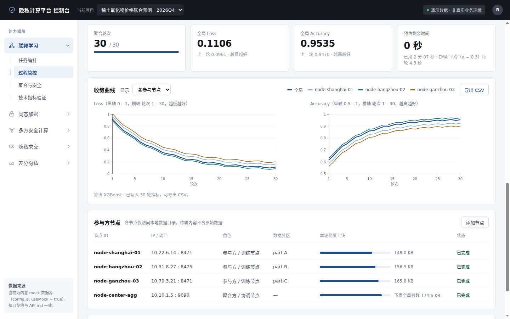

# 4 联邦学习

## 4.1 任务编排

页面入口：左侧导航「联邦学习」→「任务编排」。

### 4.1.1 项目创建（FL-ORCH-01）

功能说明：提供项目创建接口/界面，包含字段：项目名称、描述、模型版本、聚合轮数、训练目标

界面位置：任务编排 → 当前项目卡 → 「＋ 新建项目」按钮

操作步骤：

1. 点击「＋ 新建项目」，「导入演示数据」复选框默认勾选
2. 填写项目名称、项目类型、描述，选择基准模型与模型版本，填写聚合轮数，选择训练目标指标并填写目标值（例如 RMSE 归一化 ≤ 0.12）
3. 点击「创建项目」
4. 勾选导入演示数据时，新项目带 2 个训练节点 + 1 个聚合节点、4 张演示数据集和 2 个示例任务；不勾选则为空项目
5. 顶栏「当前项目」下拉出现新项目并自动切换，项目列表新增一行

预期结果：新项目出现在项目列表与顶栏，当前项目卡显示的模型版本、聚合轮数、训练目标与填写一致；名称为空、重名、轮数越界、目标值越界、基准模型与训练目标任务类型不匹配时弹窗内提示错误且不创建

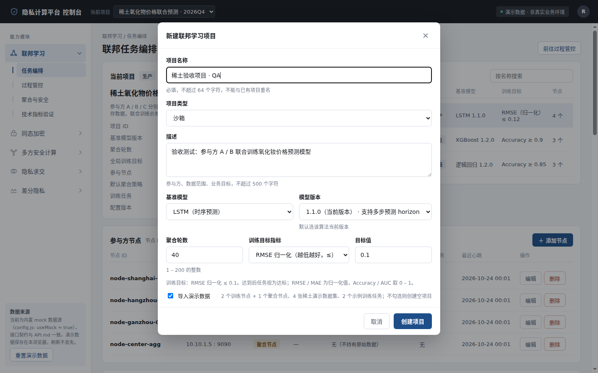

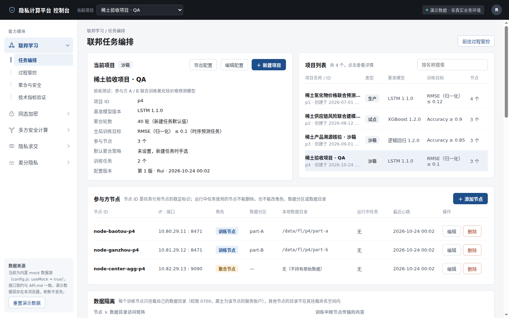

### 4.1.2 节点管理（FL-ORCH-02）

功能说明：实现参与方节点管理：支持添加/删除/编辑节点信息（节点ID、IP/端口、角色、数据分区标识）

界面位置：任务编排 → 参与方节点卡（「＋ 添加节点」、每行「编辑」「删除」）

操作步骤：

1. 点击「＋ 添加节点」，填写节点 ID、IP、端口、角色、数据分区标识（可选本地数据目录），点击「添加」
2. 在新节点行点「编辑」修改端口或角色并保存
3. 在新节点行点「删除」并确认
4. 在过程管控页启动一个训练任务后回到本页：该任务使用的节点「删除」按钮置灰，编辑角色被拒

预期结果：节点表即时增删改；IP 格式错误、端口越界、重复节点 ID、连通性失败分别给出明确错误；运行中任务使用的节点不能删除、不能改节点 ID / 角色 / 数据分区 / 数据目录，可改 IP 与端口

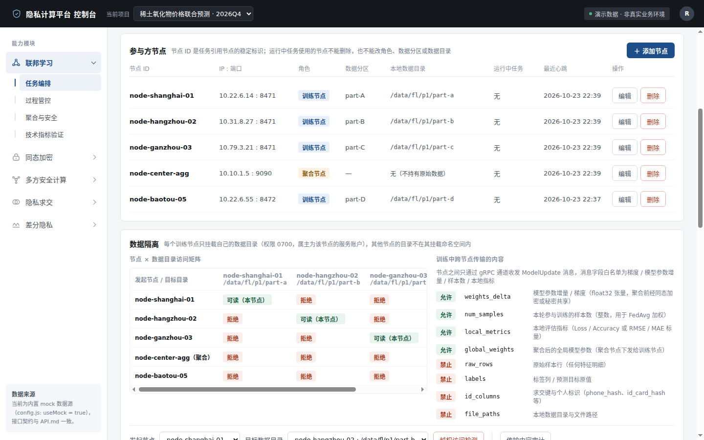

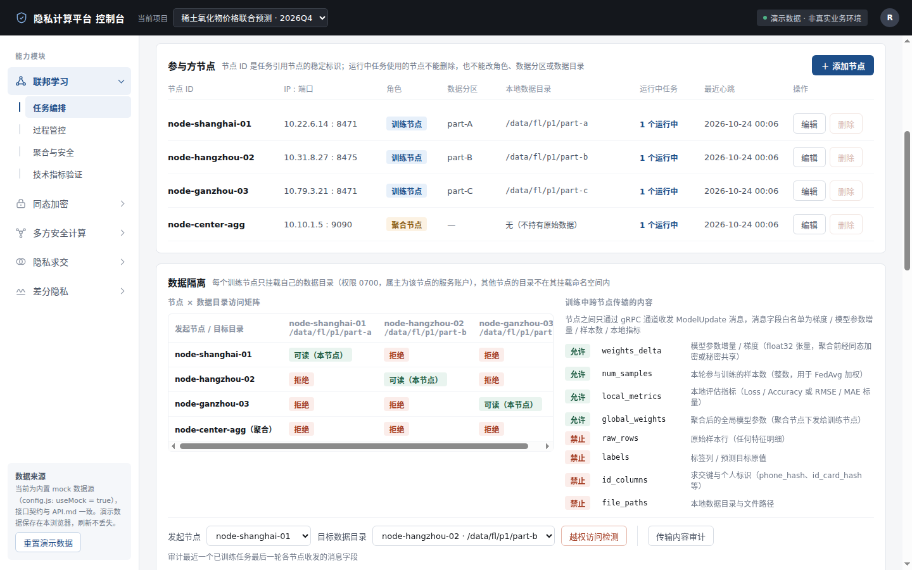

### 4.1.3 数据隔离（FL-ORCH-03）

功能说明：实现数据隔离逻辑：各节点只能访问自己的本地数据目录，训练过程中梯度/参数传输不包含原始数据

界面位置：任务编排 → 数据隔离卡（访问矩阵、传输内容清单、「越权访问检测」「传输内容审计」按钮、检测记录表）

操作步骤：

1. 查看节点 × 数据目录访问矩阵：每个训练节点只有本节点目录为「可读」，其余为「拒绝」，聚合节点全部「拒绝」
2. 发起节点选 node-shanghai-01，目标目录选 node-hangzhou-02，点击「越权访问检测」
3. 点击「传输内容审计」

预期结果：越权检测记录为「已拒绝」，说明为 EACCES 拒绝日志及目标路径；传输审计记录为「通过」，列出最后一轮每个节点上传 / 下发的参数个数、明文大小与按聚合方式计算的链路传输量，并说明稀疏化保留比例与编码方式，训练节点只含 weights_delta / num_samples / local_metrics，聚合节点只下发 global_weights / round，与本项目数据集列名比对命中 0 个

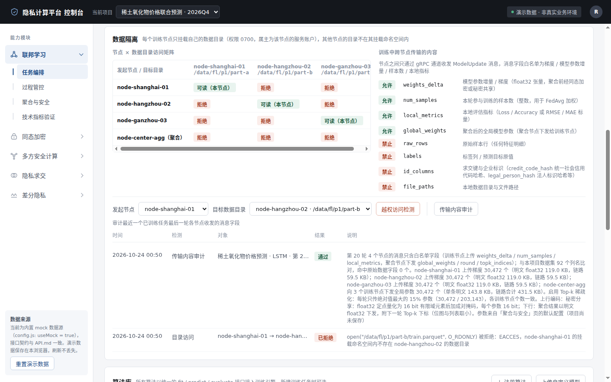

### 4.1.4 项目配置（FL-ORCH-04）

功能说明：项目配置持久化存储（数据库/配置文件），支持项目列表查询与详情查看

界面位置：任务编排 → 当前项目卡（「编辑配置」「导出配置」）+ 项目列表卡（搜索框、点击行查看详情）

操作步骤：

1. 在项目列表搜索框输入「供应链」，列表只剩对应项目
2. 点击任一项目行，弹出项目详情，可「切换到此项目」
3. 点击「编辑配置」修改名称、聚合轮数、训练目标并保存，当前项目卡配置版本 +1，顶栏名称同步更新
4. 点击「导出配置」下载 fl_project_{项目 ID}_config.json

预期结果：列表、详情与修改后的值一致；配置版本号、修改人、修改时间更新；导出文件包含项目、训练配置、节点清单与隔离策略；非法修改（轮数越界、重名、目标指标与基准模型不匹配）被拒且原配置不变

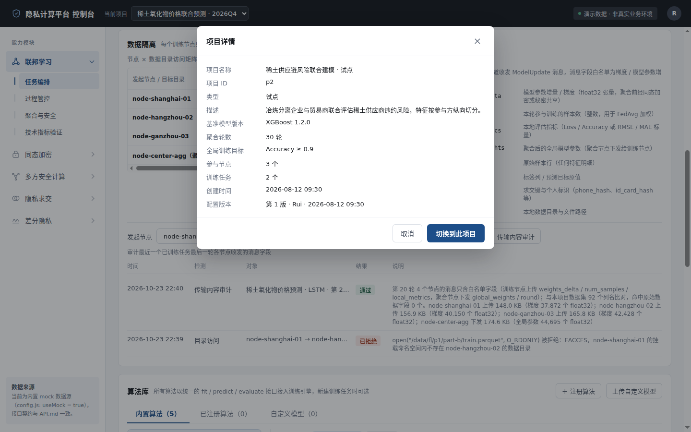

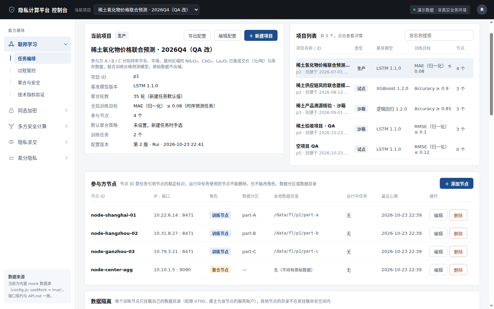

### 4.1.5 内置算法（FL-ORCH-05）

功能说明：内置算法：逻辑回归、XGBoost、CNN（或MLP）三种基类实现，统一训练/预测接口

界面位置：任务编排 → 算法库卡 → 「内置算法」页签 → 点选算法，右侧「统一训练 / 预测接口」「参数 schema」

操作步骤：

1. 打开「内置算法」页签，左侧列出逻辑回归、XGBoost、CNN / MLP、LSTM、TCN
2. 依次点选，查看右侧基类、实现框架、统一接口表（fit / predict / evaluate 的签名、输入、输出）与参数 schema

预期结果：5 个内置算法都以 fit / predict / evaluate 三个同名方法暴露，分类算法输入 ndarray[n_samples, n_features]、评估返回 loss / accuracy，时序算法输入 ndarray[n_samples, window_size, n_features]、评估返回 rmse / mae；新建训练任务弹窗的算法下拉显示各算法当前版本

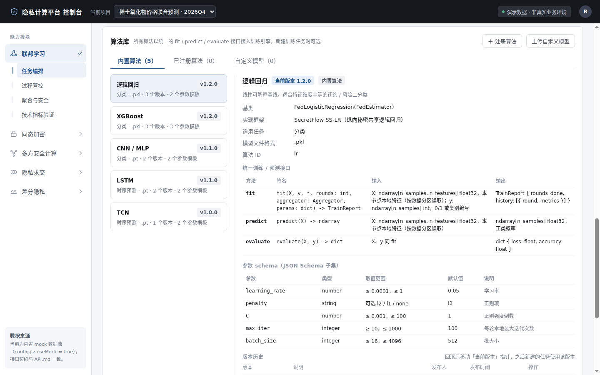

### 4.1.6 算法注册（FL-ORCH-06）

功能说明：提供算法注册机制：算法名、版本、参数schema、模型文件格式

界面位置：任务编排 → 算法库卡 → 「＋ 注册算法」按钮 → 「已注册算法」页签

操作步骤：

1. 点击「＋ 注册算法」，填写算法名、版本、模型文件格式、继承基类、适用任务类型、说明与参数 schema（JSON）
2. 先填写非法 JSON 点「注册」，弹窗提示 schema 不合法；改为合法 schema 后注册
3. 自动切到「已注册算法」页签并选中新算法，可查看接口与参数 schema
4. 到过程管控页「＋ 新建训练任务」，分类任务的算法下拉出现「LightGBM-Fed 1.0.0（已注册）」，参数表单按其 schema 渲染，创建成功

预期结果：注册成功后算法可查看、可在新建任务中选择；版本号格式、模型格式、schema 子集规则、与内置算法重名、同名同版本重复均被拒绝并给出具体原因；过程管控页任务列表「算法」列、当前任务头与算法下拉显示「名称 v版本（已注册）」

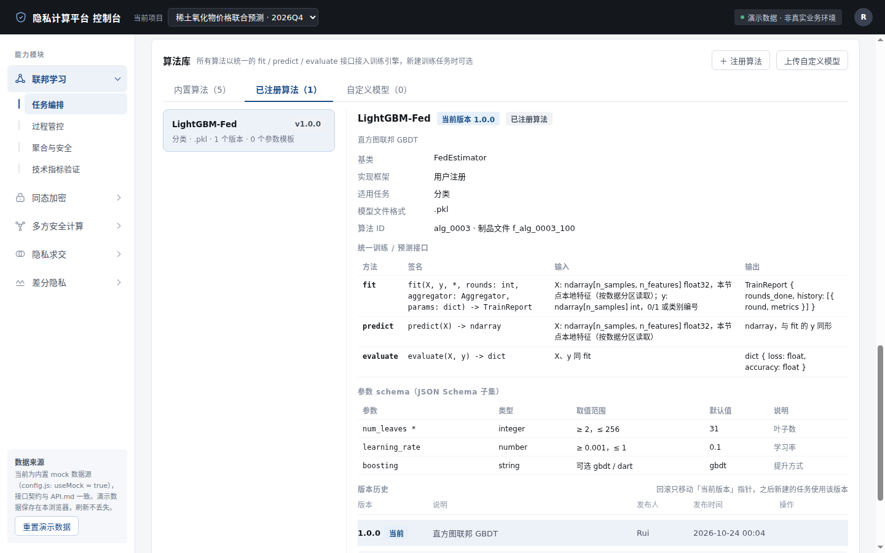

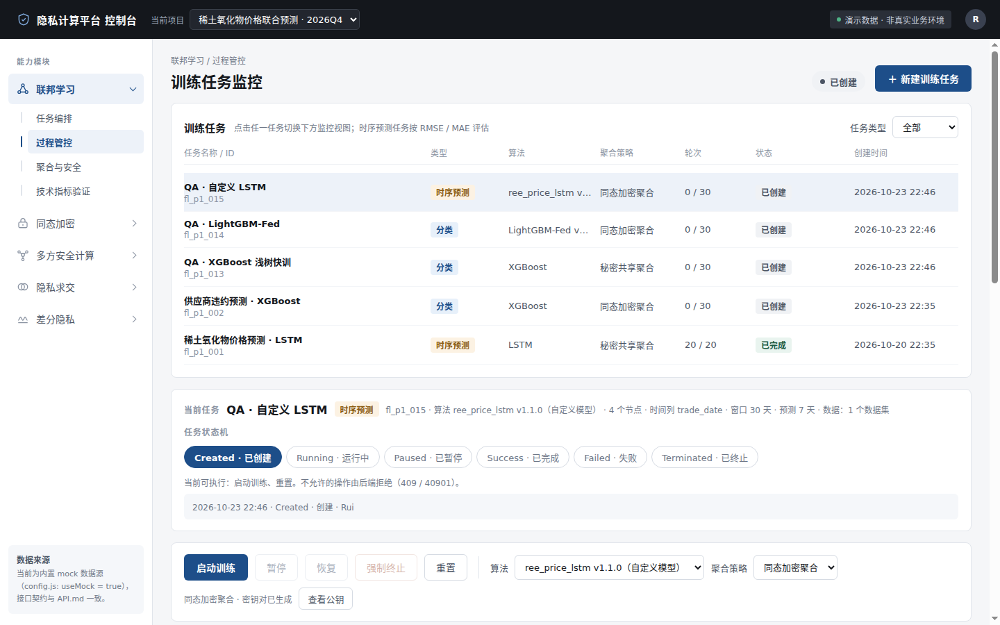

### 4.1.7 自定义模型上传（FL-ORCH-07）

功能说明：自定义模型上传：前端上传（.pkl/.pt/.h5等），后端校验模型结构完整性

界面位置：任务编排 → 算法库卡 → 「上传自定义模型」按钮 → 「自定义模型」页签 → 「模型结构校验」区块

操作步骤：

1. 点击「上传自定义模型」，选择 corrupt_model.h5（文件名含 corrupt），点击「上传并校验」
2. 弹窗内显示结构校验报告：文件格式通过、文件大小通过、文件头与序列化结构失败及原因，模型未登记
3. 改选 ree_price_lstm.pt，任务类型选「时序预测」，再次上传并校验
4. 切到「自定义模型」页签，右侧显示层数、参数量（含估算口径）、输入形状、输出形状与逐项校验结果

预期结果：.pkl / .pt / .h5 / .onnx 可上传；文件损坏或为空时校验失败并说明原因（例如 HDF5 文件签名不匹配、文件为空 0 B），不登记模型；通过的模型给出层数、参数量与输入形状，只在本项目可见并可在新建训练任务中选择；用自定义模型创建的任务在过程管控页显示「名称 v版本（自定义模型）」

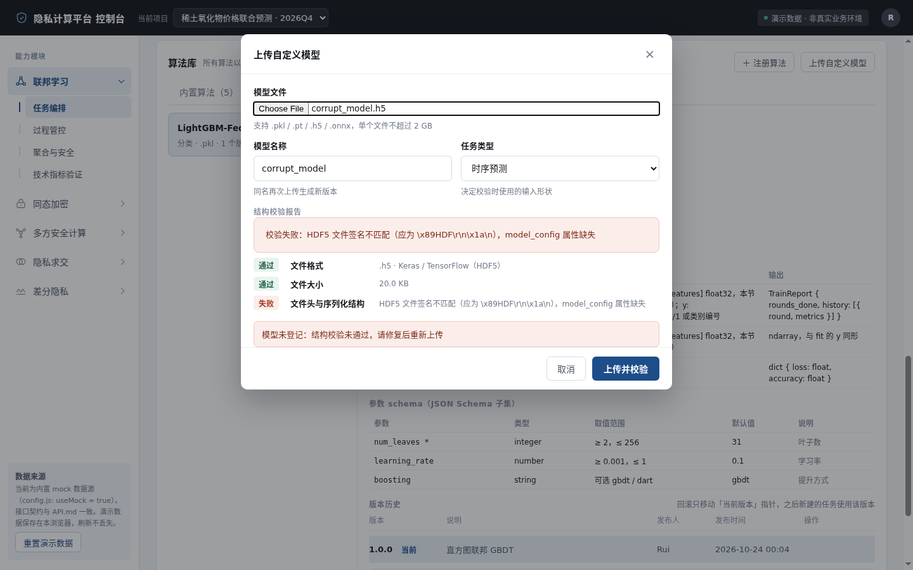

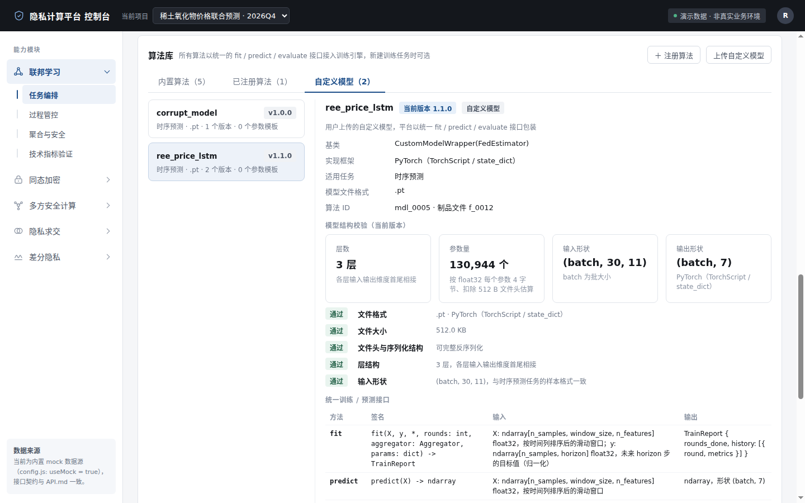

### 4.1.8 模型版本管理（FL-ORCH-08）

功能说明：模型版本管理：保存历史版本，支持回滚

界面位置：任务编排 → 算法库卡 → 任一算法详情 → 「版本历史」区块（「回滚到此版本」按钮 + 操作记录）

操作步骤：

1. 选中 XGBoost，版本历史列出 1.2.0（当前）、1.1.0、1.0.0 及说明、发布人、发布时间
2. 在 1.1.0 行点击「回滚到此版本」，填写回滚原因并确认
3. 当前版本标记移到 1.1.0，操作记录新增「Rui · 回滚 1.2.0 → 1.1.0（原因）」，算法下拉与新建任务弹窗显示 XGBoost 1.1.0
4. 自定义模型同名再次上传，版本历史出现 1.1.0，可回滚到 1.0.0

预期结果：历史版本全部保留；回滚后当前版本标记改变，记录操作人、时间与原因；之后新建的任务 algo_ref.version 为回滚后的版本，已创建任务不受影响；回滚到当前版本或不存在的版本被拒绝

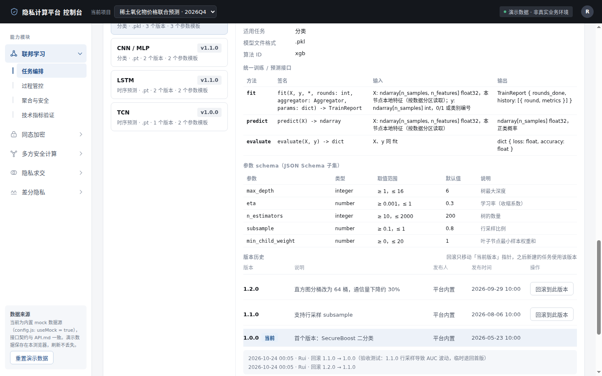

### 4.1.9 算法参数模板（FL-ORCH-09）

功能说明：算法参数模板：预置常用参数组合，支持用户自定义参数

界面位置：任务编排 → 算法库卡 → 算法详情 → 「参数模板」区块；过程管控 → 「＋ 新建训练任务」弹窗 → 「参数模板」下拉

操作步骤：

1. 选中 XGBoost，参数模板区列出平台预置的「默认参数」「快速基线」「高精度（慢）」及其参数组合
2. 点击「＋ 另存为模板」，填写模板名「浅树快训」、max_depth = 99，保存被拒（不能大于 16）；改为 3 后保存，列表出现自定义模板
3. 到过程管控页「＋ 新建训练任务」，选算法 XGBoost，「参数模板」下拉选「浅树快训」，下方参数表单自动填充，创建任务

预期结果：每个内置算法至少 2 个预置模板；自定义模板按算法 schema 校验（越界、类型错误、未知参数、重名被拒），未填参数取默认值；平台预置模板不可删除，自定义模板可删除；新建任务时选模板即填充参数，任务记录 params 与 template_id

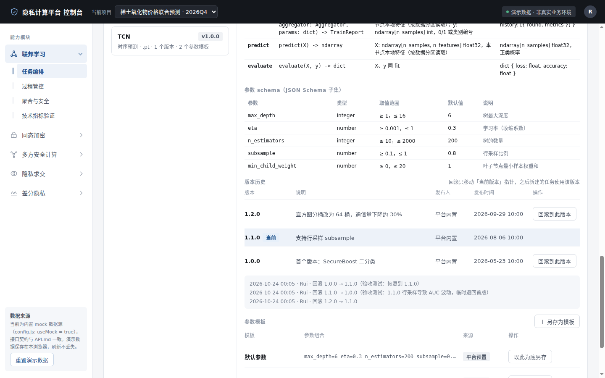

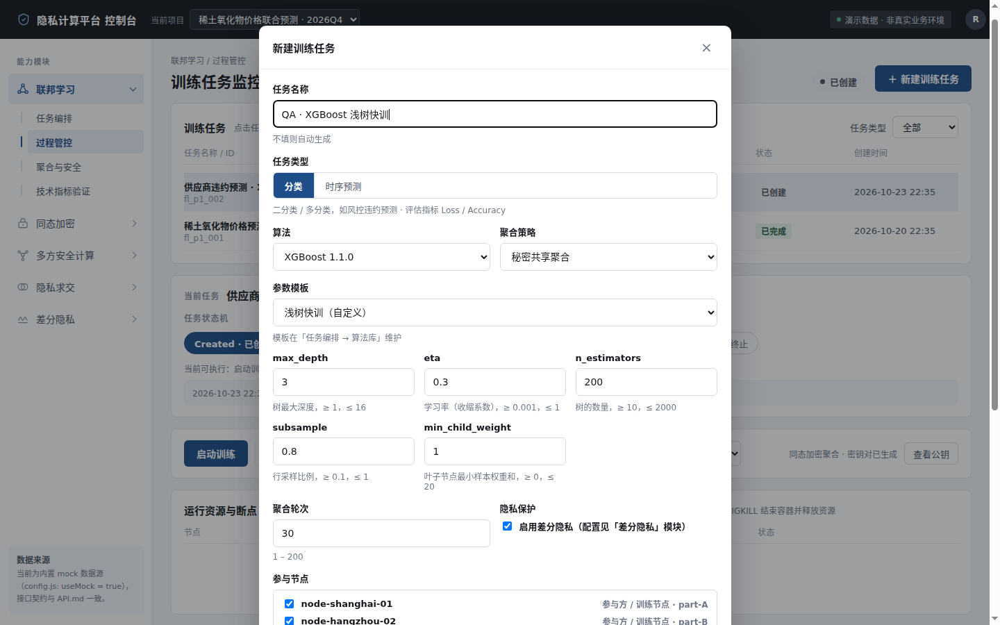

## 4.2 过程管控

页面入口：左侧导航「联邦学习」→「过程管控」。

### 4.2.1 可视化任务状态机（FL-PROC-01）

功能说明：实现任务状态机：状态包括Created、Running、Paused、Success、Failed、Terminated

界面位置：过程管控 → 当前任务卡「任务状态机」（六个状态标签、当前可执行动作、最近迁移记录、失败原因）+ 控制栏按钮

操作步骤：

1. 选中「供应商违约预测 · XGBoost」，状态标签高亮 Created，提示当前可执行「启动训练、重置」，暂停 / 恢复 / 强制终止按钮置灰
2. 依次点击「启动训练」「暂停」「恢复」，状态标签依次变为 Running、Paused、Running，迁移记录逐条追加（时间 · 原状态 → 新状态 · 动作 · 操作人）
3. 在任务编排页把 node-hangzhou-02 的在线状态改为离线：任务转 Failed，显示失败原因；跑满轮次的任务自动转 Success；点「强制终止」转 Terminated

预期结果：Created、Running、Paused、Success、Failed、Terminated 六种状态都可到达；按钮可用性与迁移表一致；不允许的动作由后端返回 40901 并给出 allowed_actions

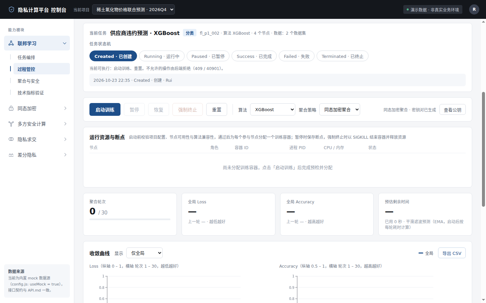

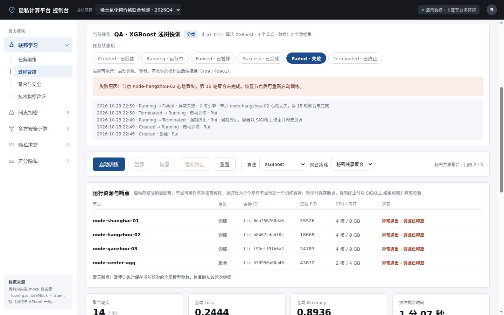

### 4.2.2 任务启动（FL-PROC-02）

功能说明：任务启动：校验项目配置、参与方节点可用性、算法兼容性，分配训练进程/容器

界面位置：过程管控 → 「启动训练」按钮 + 「运行资源与断点」卡

操作步骤：

1. 点击「启动训练」，提示「启动校验通过（项目配置、节点可用性、算法兼容性），已分配 4 个训练容器」
2. 「运行资源与断点」卡列出每个节点的容器 ID、进程 PID、CPU / 内存与状态「运行中」
3. 把任一参与节点置为离线后再次启动，提示「节点不可用：… 心跳丢失（离线）」，任务状态不变

预期结果：三项预检全部通过才启动并分配容器；节点离线返回 42201，节点被移除返回 40901，节点不足或算法不兼容返回 40000，预检失败时任务不改变状态

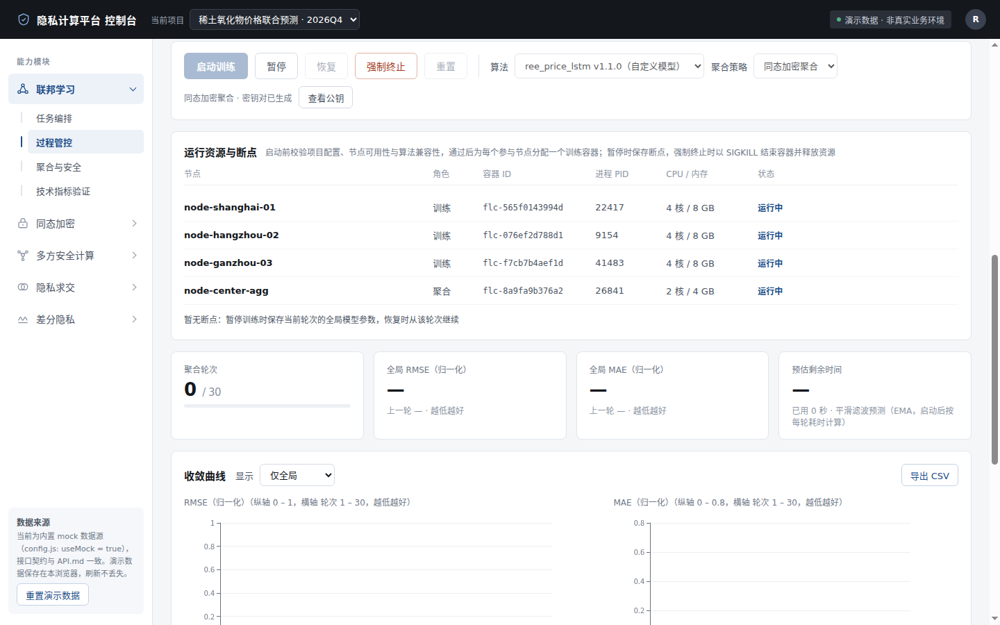

### 4.2.3 任务暂停与恢复（FL-PROC-03）

功能说明：暂停与恢复：中断聚合循环并保存当前轮次参数，恢复时从断点继续

界面位置：过程管控 → 「暂停」「恢复」按钮 + 「运行资源与断点」卡的「最近断点」

操作步骤：

1. 训练进行到第 5 轮时点击「暂停」，提示「第 5 轮断点已保存」，容器状态变为「已挂起（断点已保存）」，下方显示断点路径、模型大小与 SHA-256
2. 等待数秒，聚合轮次停在 5
3. 点击「恢复」，提示「已从第 5 轮断点继续训练」，曲线从第 6 轮继续

预期结果：暂停期间聚合循环中断、轮次不再增加；恢复后从断点下一轮继续，已存储的指标轮次连续、不重复不丢失；对已暂停任务再暂停、对运行中任务恢复均返回 40901

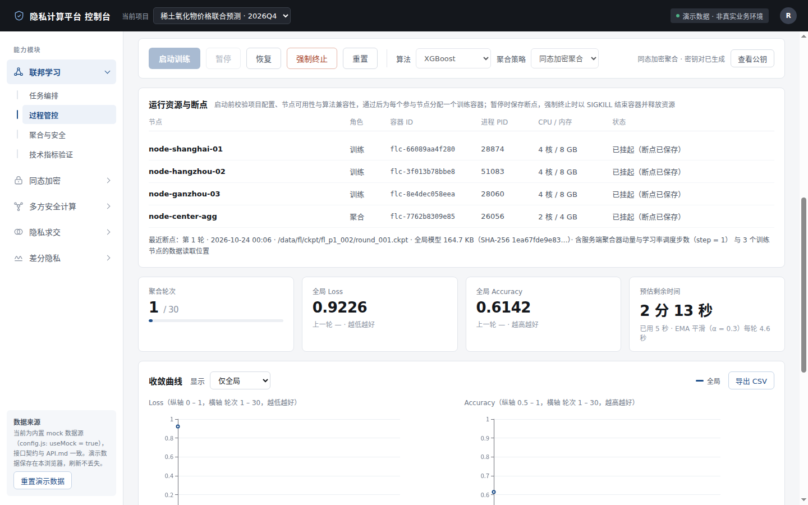

### 4.2.4 任务强制终止（FL-PROC-04）

功能说明：强制终止：Kill训练进程，释放资源，状态迁移至Terminated

界面位置：过程管控 → 「强制终止」按钮 + 「运行资源与断点」卡

操作步骤：

1. 训练运行中点击「强制终止」，弹出确认框，写明将以 SIGKILL 结束全部容器、丢弃正在进行那一轮尚未聚合的本地更新、保留已完成轮次指标与断点；点「确认终止」后提示「已强制终止，训练容器已释放」
2. 状态标签变为 Terminated，所有容器状态为「已强制结束 · 资源已释放」，轮次不再增加
3. 任务编排页该任务使用的节点「运行中任务」归零，可删除或改角色

预期结果：终止后训练停止、资源释放、状态为 Terminated；对 Created 或已终止任务再终止返回 40901；终止后可重新启动（从第 0 轮开始并重新分配容器）

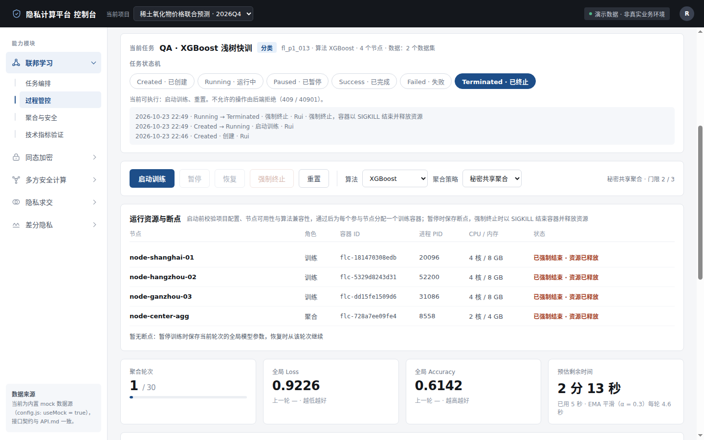

### 4.2.5 数据存储（FL-PROC-05）

功能说明：训练过程中每轮聚合后计算并存储全局和各节点的Loss、Accuracy

界面位置：过程管控 → 聚合轮次 / 全局指标卡 + 收敛曲线卡

操作步骤：

1. 启动训练，每完成一轮聚合，「聚合轮次」加 1，全局 Loss / Accuracy 卡显示本轮与上一轮数值
2. 时序任务显示 RMSE / MAE（归一化）

预期结果：每轮聚合后存储全局与每个训练节点的指标（聚合节点不持有数据，无本地指标）（分类 Loss / Accuracy，时序 RMSE / MAE）和写入时间，可通过指标接口按轮次读取

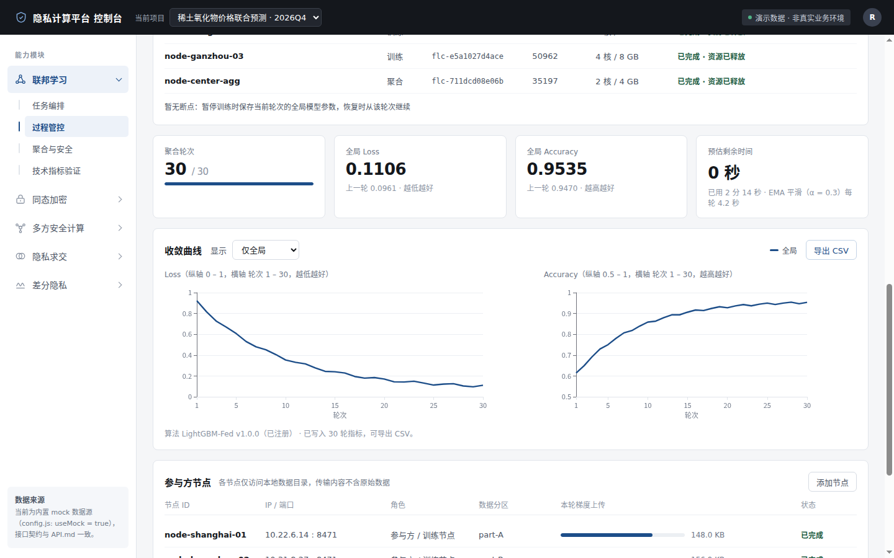

### 4.2.6 绘制动态曲线（FL-PROC-06）

功能说明：前端基于ECharts绘制动态曲线：支持切换显示全局/各节点曲线，横轴为轮次，纵轴为指标值

界面位置：过程管控 → 收敛曲线卡（「显示：仅全局 / 各参与节点」下拉、图例、两张 ECharts 折线图）

操作步骤：

1. 训练运行中，两张 ECharts 折线图随每轮推送实时延长，横轴为轮次 1 – 总轮次，纵轴为指标值（量纲取任务类型的 metrics_spec）
2. 「显示」切到「各参与节点」，图例出现全局与 3 个训练节点，各节点曲线同时绘制
3. 切回「仅全局」只剩一条曲线
4. 鼠标悬停曲线，tooltip 显示「第 N 轮 · 指标名」与每条曲线的数值；缩放窗口时图表随容器自适应

预期结果：曲线随轮次动态更新，可在全局与各节点之间切换；接口支持 from_round / to_round 截取区间，非法区间返回 40003 / 40002

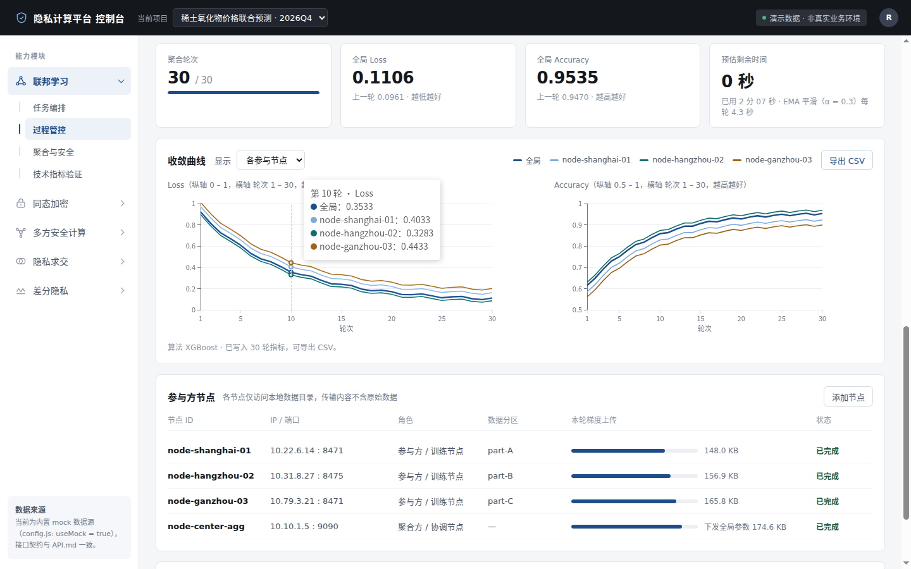

### 4.2.7 预估剩余时间（FL-PROC-07）

功能说明：预估剩余时间：根据已用时间、已完成轮次、目标总轮次，采用平滑滤波预测

界面位置：过程管控 → 「预估剩余时间」指标卡（悬停显示公式）

操作步骤：

1. 启动训练，「预估剩余时间」每轮刷新，下方显示已用时间与「EMA 平滑（α = 0.3）每轮 X 秒」
2. 出现慢轮次（约每 11 轮一次）时，剩余时间只小幅上调，不会大幅跳变
3. 训练完成后剩余时间为 0 秒

预期结果：剩余时间由已用时间、已完成轮次与总轮次经指数平滑得出；未开始时为「—」；列表、详情与 ETA 接口数值一致

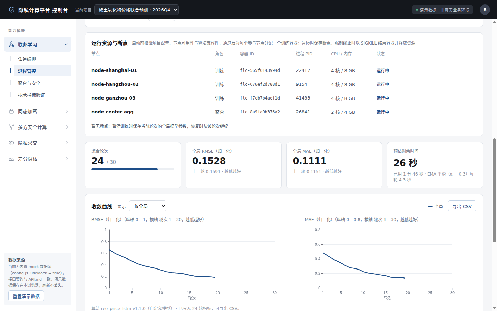

### 4.2.8 查询与导出（FL-PROC-08）

功能说明：提供历史指标查询接口：按时间范围或项目ID查询，支持导出CSV

界面位置：过程管控 → 「历史指标查询」卡（范围：当前任务 / 当前项目全部任务 / 全部项目，开始 / 结束时间，曲线，查询，导出 CSV）+ 收敛曲线卡「导出 CSV」

操作步骤：

1. 范围选「当前项目全部任务」，曲线选「全局 + 各节点」，点击「查询」，显示「共 N 条（M 个任务）」与前 50 条记录
2. 开始时间填未来时间再查询，显示 0 条
3. 清空时间后点「导出 CSV」，下载 fl_metrics_{项目 ID}.csv

预期结果：可按项目 ID、任务 ID 和写入时间范围查询历史指标，导出的 CSV 列为 project_id,job_id,task_type,round,series,loss,accuracy,rmse,mae,recorded_at(UTC+8)，时间写成「2026-10-23 22:10:05 +08:00」，行数与查询条数一致；时间格式错误返回 40002，开始晚于结束返回 40003 并提示「开始时间不能晚于结束时间」，项目不存在返回 40400

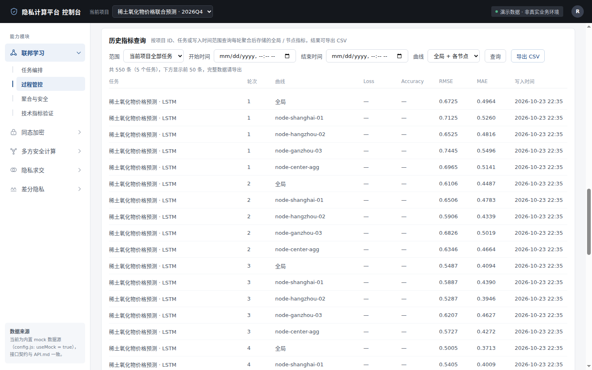

## 4.3 聚合与安全

页面入口：左侧导航「联邦学习」→「聚合与安全」。

### 4.3.1 一键聚合策略配置（FL-AGG-01）

功能说明：下拉选择策略，动态展示对应参数表单，支持秘密共享聚合、同态加密聚合一键设置。

界面位置：聚合与安全 → 聚合策略卡 → 「策略」下拉 + 「套用推荐配置」

操作步骤：

1. 打开 #/fed/agg
2. 「策略」下拉在秘密共享聚合与同态加密聚合之间切换，观察下方参数卡随之切换（秘密共享参数卡 / 同态加密参数卡 + 密钥对卡）
3. 点击「套用推荐配置」，表单填入推荐值，页头提示「有未保存的修改」

预期结果：切换策略后只显示该策略的参数表单与说明；推荐配置说明行写清门限 t = ⌊n/2⌋ + 1、掉线容忍 d = n − t 等推荐规则，套用后各输入框为推荐值

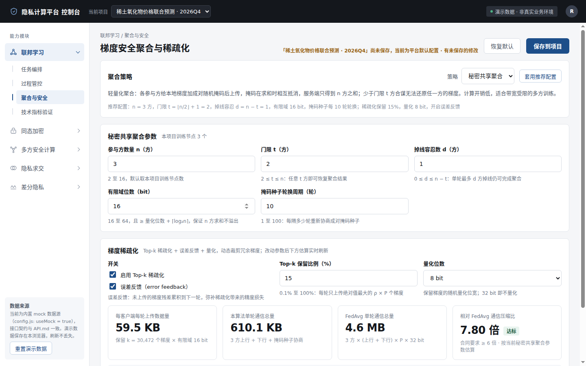

### 4.3.2 秘密共享聚合（FL-AGG-02）

功能说明：支持自定义编辑秘密共享聚合参数

界面位置：聚合与安全 → 秘密共享聚合参数卡

操作步骤：

1. 策略选「秘密共享聚合」
2. 修改参与方数量 n、门限 t、掉线容忍数 d、有限域位数、掩码种子轮换周期
3. 把门限 t 改为大于 n 的值（如 4），观察输入框下的错误提示
4. 改回合法值后点击「保存到项目」

预期结果：越界值即时在对应输入框下显示「门限 t 超出范围：允许 2 至 3，当前 4」类提示，估算区显示参数不合法；合法值保存成功，刷新页面后保持

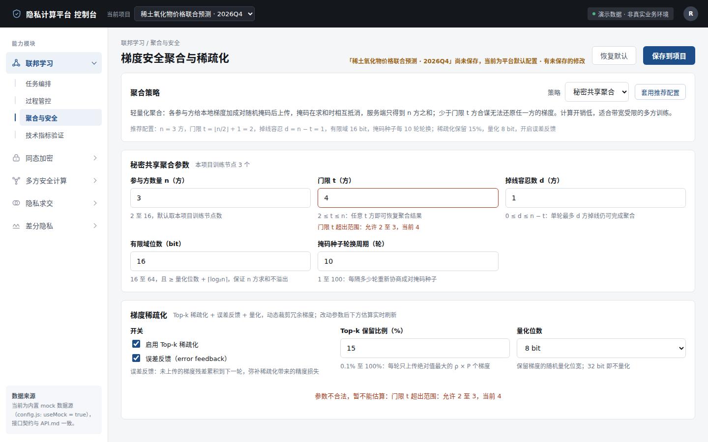

### 4.3.3 同态加密聚合（FL-AGG-03）

功能说明：支持自定义编辑同态加密聚合参数

界面位置：聚合与安全 → 同态加密聚合参数卡

操作步骤：

1. 策略选「同态加密聚合」
2. 方案选 Paillier，修改密钥长度、定点编码精度、批打包大小；把批打包改为 128 观察超出明文空间的提示
3. 方案切换为 CKKS，修改多项式阶数 N、系数模数总位数、缩放因子位数、批打包大小；把系数模数改为 300（N = 8192）观察提示

预期结果：两种方案的参数表单动态切换；Paillier 打包超出明文空间、CKKS 系数模数超过 128 bit 安全上限或批打包超过 N/2 时给出带具体数值的错误；估算区同步显示密文个数与单密文位数

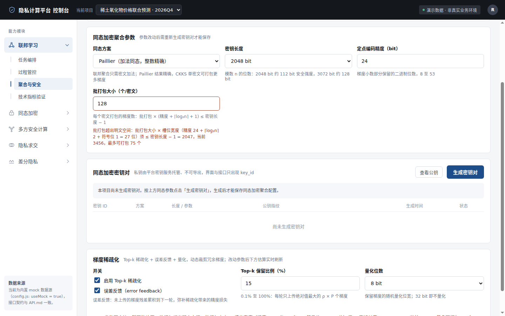

### 4.3.4 密钥对生成（FL-AGG-04）

功能说明：同态加密模式下，生成密钥对且公钥信息可查看

界面位置：聚合与安全 → 同态加密聚合 → 同态加密密钥对卡 → 「生成密钥对」「查看公钥」

操作步骤：

1. 进入聚合与安全，策略选「同态加密聚合」：密钥对卡直接显示同态加密模块当前在用的聚合密钥（如 hek_0002，Paillier 2048 bit），密钥列表含其轮换历史，与过程管控任务显示的公钥一致
2. 点击「查看公钥」，弹窗显示密钥 ID、所属项目、方案、密钥长度与安全强度、公钥大小、SHA256 指纹、生成时间、完整公钥（Paillier 模数 n）与私钥托管说明
3. 点击「生成密钥对」，列表出现新的 flk_ 密钥（有效），原在用密钥变为「已轮换」
4. 修改密钥长度后不重新生成直接保存，提示参数与密钥不一致；在同态加密页销毁在用密钥后，查看公钥提示当前没有在用密钥

预期结果：初始状态、密钥列表、过程管控与同态加密页口径一致，项目同时只有一把在用的聚合密钥；公钥信息完整可查看，私钥只显示 KMS 引用与 key_id；同态参数与有效密钥不一致时不能保存

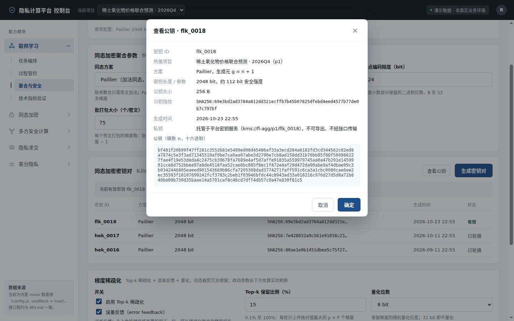

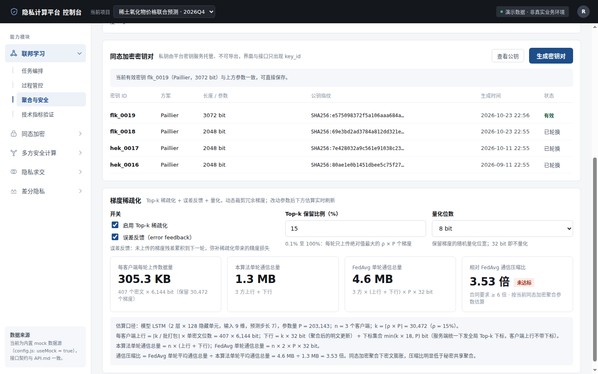

### 4.3.5 参数重置（FL-AGG-05）

功能说明：一键恢复聚合策略

界面位置：聚合与安全 → 页头「恢复默认」→ 确认弹窗

操作步骤：

1. 修改任意参数并保存
2. 点击「恢复默认」，弹窗说明将恢复的默认值
3. 点击弹窗「恢复默认」

预期结果：策略回到秘密共享聚合，门限 2、有限域 16 bit、Top-k 15%、量化 8 bit、开启误差反馈，并已保存（页头显示保存时间）；已生成的密钥对保留

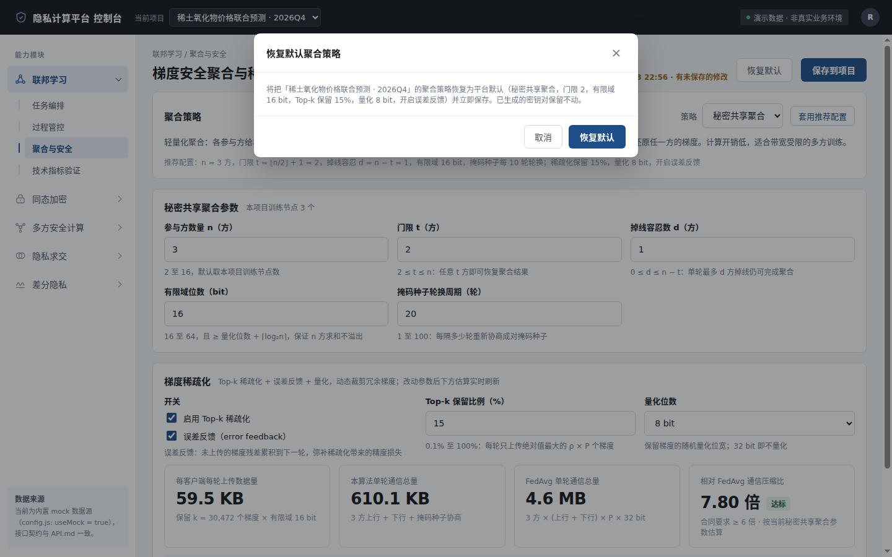

### 4.3.6 参数配置保存（FL-AGG-06）

功能说明：保存当前策略及参数到当前联邦项目

界面位置：聚合与安全 → 页头「保存到项目」+ 保存状态提示

操作步骤：

1. 修改参数，页头出现「有未保存的修改」
2. 点击「保存到项目」
3. 切换到其他项目再切回，或刷新后重新进入

预期结果：提示「已保存…配置到「项目名」」，页头显示保存时间；配置按项目隔离，切回后保持；任务编排页新建任务默认聚合方式随之变化

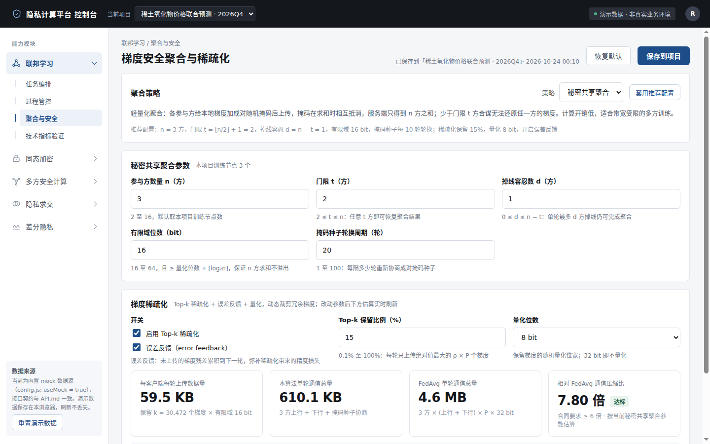

### 4.3.7 梯度稀疏化（FL-AGG-07）

功能说明：Top-k 稀疏化 + 误差反馈，动态裁剪冗余梯度，展示每轮上传数据量与相对 FedAvg 的通信压缩比

界面位置：聚合与安全 → 梯度稀疏化卡（开关、Top-k 保留比例、误差反馈、量化位数、四个估算指标、公式说明）

操作步骤：

1. 查看默认估算：每客户端每轮上传 59.5 KB、本算法单轮 610.1 KB、FedAvg 单轮 4.6 MB、压缩比 7.80 倍（达标）
2. 把 Top-k 保留比例改为 40%，压缩比降到 6 倍以下并显示「未达标」
3. 关闭「启用 Top-k 稀疏化」，观察压缩比与公式说明变化
4. 切换到同态加密聚合，观察密文膨胀导致压缩比下降

预期结果：四个指标与公式说明随参数实时刷新，公式写明 压缩比 = FedAvg 单轮平均通信总量 ÷ 本算法单轮平均通信总量，并代入当前数值

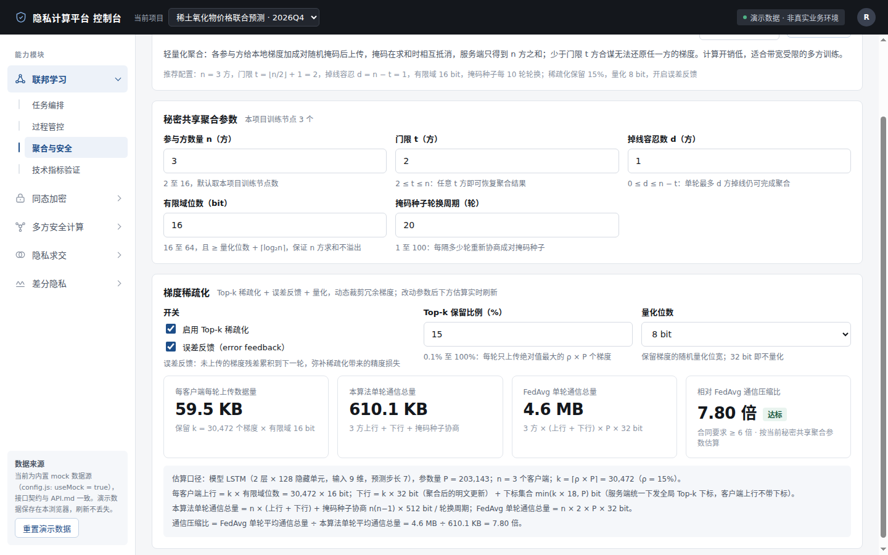

## 4.4 技术指标验证

页面入口：左侧导航「联邦学习」→「技术指标验证」。

### 4.4.1 梯度重构攻击评估（FL-EVAL-01）

功能说明：稀土氧化物价格时序数据集、1 服务端 + 3 客户端；对截获的梯度运行 DLG、iDLG，统计还原成功率（合同要求 ≤5%）

界面位置：技术指标验证 → 梯度重构攻击评估卡

操作步骤：

1. 页面顶部数据来源说明写明「当前数值来自原型内置评估引擎的仿真结果」
2. 打开 #/fed/eval，梯度重构攻击评估卡保持默认配置（攻击样本 200 个、迭代 300 次、全部客户端、种子 2026）
3. 点击「开始评估」，观察进度条与阶段文字（加载数据集 → 截获上行梯度 → DLG / iDLG 分组攻击 → 统计）
4. 完成后查看达标横幅与结果表，展开「评估方法」核对攻击实现与判定口径
5. 点击「导出 CSV」（开始 / 完成时间列注明 UTC+8）下载评估报告；把攻击样本数改为 5 再开始，提示超出范围

预期结果：本算法 DLG、iDLG 还原成功率均为 0.0%（0 / 200 个样本），达标（合同阈值 ≤ 5%）；对照明文 FedAvg DLG 84.0%（168 / 200）、iDLG 85.0%（170 / 200）；表中每组给出攻击样本数、还原成功数、成功率、平均还原 MSE；同配置重复评估结果一致

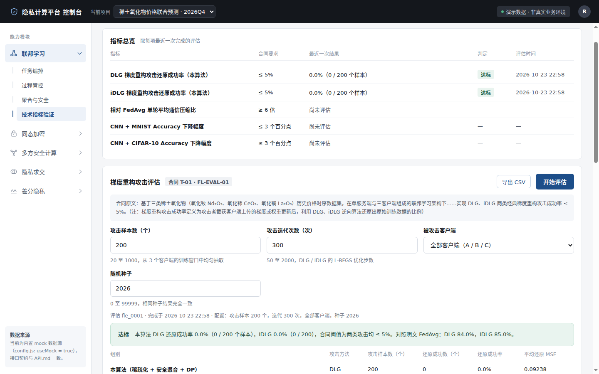

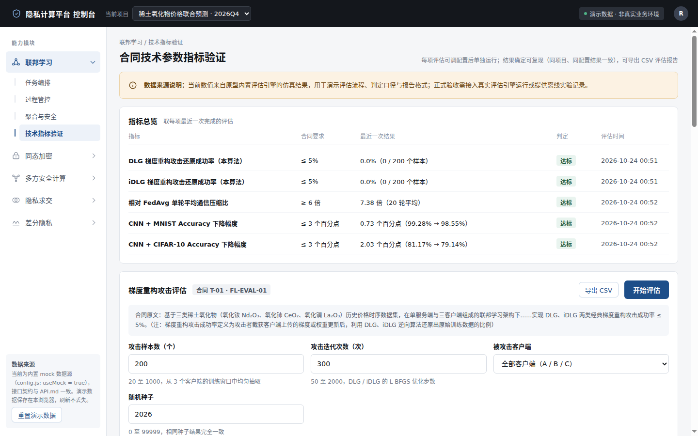

### 4.4.2 通信压缩比评估（FL-EVAL-02）

功能说明：同一任务下 FedAvg 与本算法单轮平均通信数据总量之比（合同要求 ≥6）

界面位置：技术指标验证 → 通信压缩比评估卡

操作步骤：

1. 页面顶部数据来源说明写明「当前数值来自原型内置评估引擎的仿真结果」
2. 保持默认配置（20 轮，Top-k 保留比例取项目配置 15%，量化 8 bit，误差反馈开启，有限域 16 bit），点击「开始评估」
3. 完成后查看达标横幅、模型效果表（RMSE / MAE）与逐轮通信数据量表
4. 把 Top-k 保留比例改为 40% 再评估，结果为未达标；关闭误差反馈再评估，RMSE 增幅变大
5. 点击「导出 CSV」（开始 / 完成时间列注明 UTC+8）

预期结果：单轮平均通信压缩比约 7.38 倍（FedAvg 4.650 MB ÷ 本算法 0.630 MB，20 轮平均），达标（合同阈值 ≥ 6）；本算法测试集 RMSE 相对 FedAvg 增加约 1.3%；逐轮表首轮保留量最多、随轮次回落

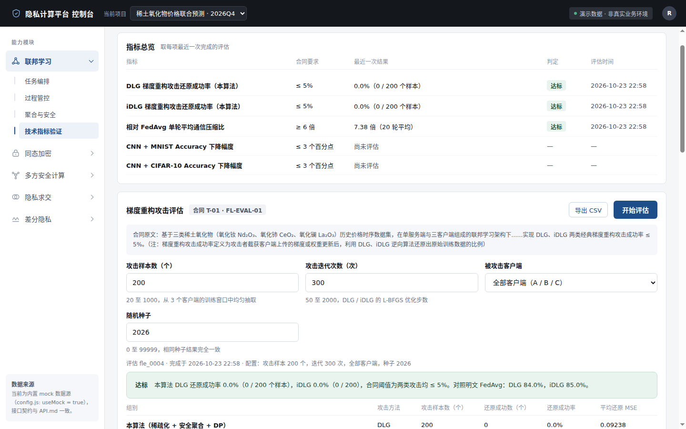

### 4.4.3 联邦训练精度衰减评估（FL-EVAL-03）

功能说明：CNN + MNIST / CIFAR-10，联邦（含隐私保护）相对集中式明文训练的 Accuracy 下降幅度（合同要求 ≤3 个百分点）

界面位置：技术指标验证 → 联邦训练精度衰减评估卡

操作步骤：

1. 页面顶部数据来源说明写明「当前数值来自原型内置评估引擎的仿真结果」
2. 保持默认配置（联邦 50 轮、本地 1 epoch、IID、种子 2026），点击「开始评估」
3. 完成后查看两数据集的集中式明文 Accuracy、联邦 Accuracy、下降百分点、相对下降与判定
4. 把联邦轮次改为 10 再评估，CIFAR-10 下降超过 3 个百分点、判定未达标
5. 点击「导出 CSV」（开始 / 完成时间列注明 UTC+8）；历史评估记录中可「查看」任一历史结果

预期结果：MNIST 99.28% → 98.55%，下降 0.73 个百分点；CIFAR-10 81.17% → 79.14%，下降 2.03 个百分点，均达标（合同阈值 ≤ 3，按百分点判定）

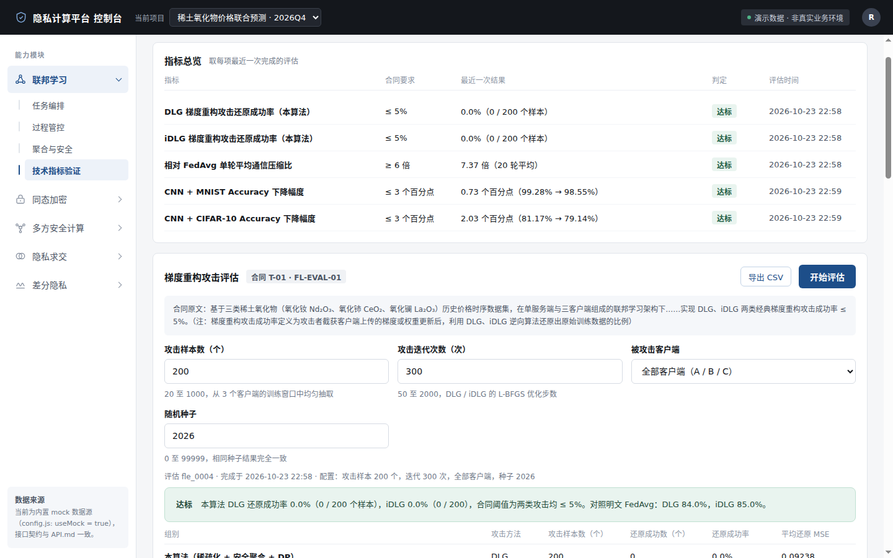

# 5 同态加密

## 5.1 算法管理

页面入口：左侧导航「同态加密」→「算法管理」。

### 5.1.1 半同态加密（HE-ALGO-01）

功能说明：实现Paillier半同态算法（支持整数加、数乘）

界面位置：算法管理 → 「算法目录」卡片 Paillier 行；「运算验证」卡片

操作步骤：

1. 打开同态加密 / 算法管理，查看算法目录 Paillier 行：半同态、支持「密文 + 密文、密文 × 明文」、安全强度 112 位（n = 2048 bit）
2. 在运算验证选择 Paillier，点「整数示例」
3. 运算选「明文数乘 A ⊗ b」后运行，查看解密还原值与绝对误差
4. 确认「密文乘法」选项被禁用并标注 Paillier 不支持

预期结果：整数加与明文数乘解密结果与明文直接计算一致，最大绝对误差 0；密文 × 密文被拒绝（40001）

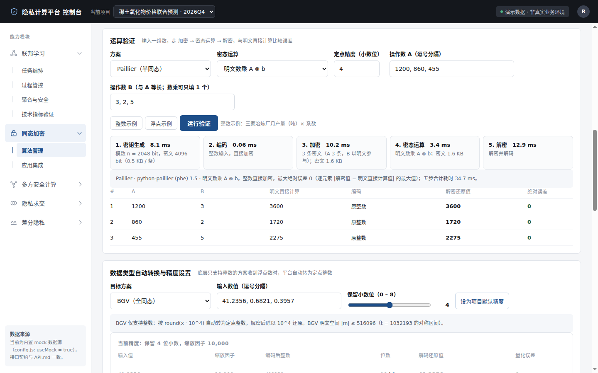

### 5.1.2 全同态加密（HE-ALGO-02）

功能说明：实现CKKS/BGV全同态算法（支持浮点数加、乘，近似计算）

界面位置：算法管理 → 「算法目录」卡片 CKKS / BGV 行；「运算验证」卡片

操作步骤：

1. 查看算法目录 CKKS（浮点近似）、BGV（模 t 整数精确）两行的支持运算、明文类型、典型参数
2. 运算验证选 CKKS，点「浮点示例」，运算为密文乘法，查看误差为 1e-6 量级的非零近似误差
3. 切换 BGV，输入整数（如 120, -35 与 42, 7）做密文乘法，误差为 0

预期结果：CKKS 加、乘可用且结果为近似值（误差非 0、远小于 1e-4）；BGV 整数加、乘精确

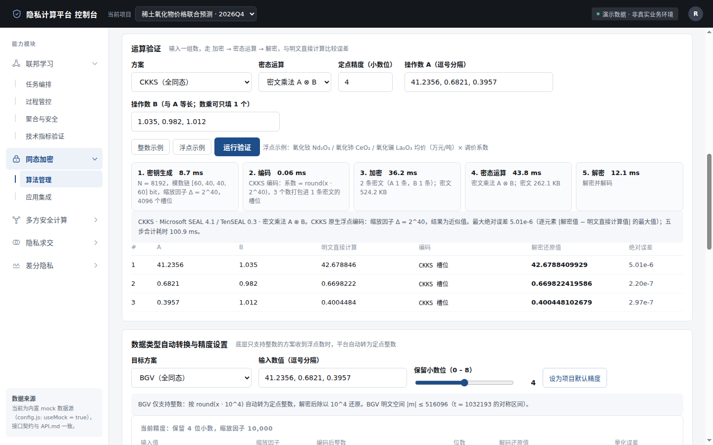

### 5.1.3 加密算法配置（HE-ALGO-03）

功能说明：支持加密基础算法切换（如SEAL TenSEAL、Pyfhel、TFHE-rs等）

界面位置：算法管理 → 「加密算法配置」卡片（默认方案、底层库、默认保留小数位、库 × 方案矩阵）

操作步骤：

1. 查看矩阵：5 个底层库 × 4 个方案，支持处为可点击的「支持」按钮
2. 点矩阵中 OpenFHE 1.2 × BGV，再点「保存为项目默认」
3. 把底层库改为 TFHE-rs 0.7、方案改为 CKKS，提示行变红说明不支持，点保存被拒绝
4. 切换顶栏项目，配置回到该项目自己的值

预期结果：合法组合保存成功并显示保存时间；不支持的组合返回 40001 并列出可选库，原配置不变；各项目配置独立

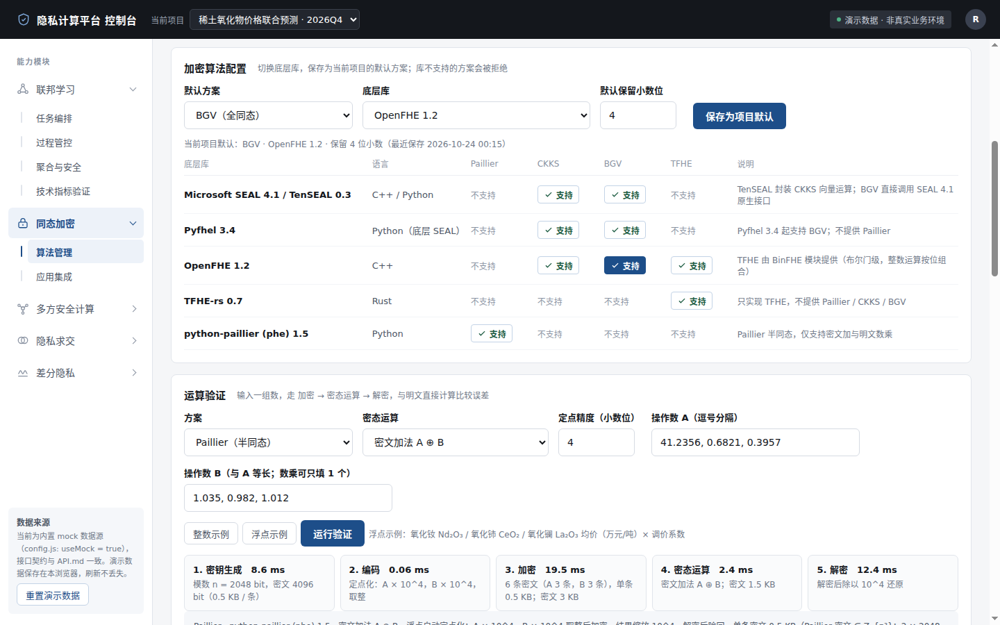

### 5.1.4 整型数据同态加密（HE-ALGO-04）

功能说明：支持整型数据的同态加密、密态运算与解密还原。

界面位置：算法管理 → 「运算验证」卡片（整数输入）

操作步骤：

1. 方案选 BGV 或 TFHE，点「整数示例」或手输整数
2. 选择密文加法 / 密文乘法 / 明文数乘并运行
3. 查看 5 步耗时（密钥生成、编码、加密、密态运算、解密）与逐行结果表
4. TFHE 下输入 50000 × 50000，提示超出 FheInt32 范围

预期结果：整数数据加密、密态运算、解密还原值与明文一致，误差 0；超出明文空间时返回 40003 并在结果区说明

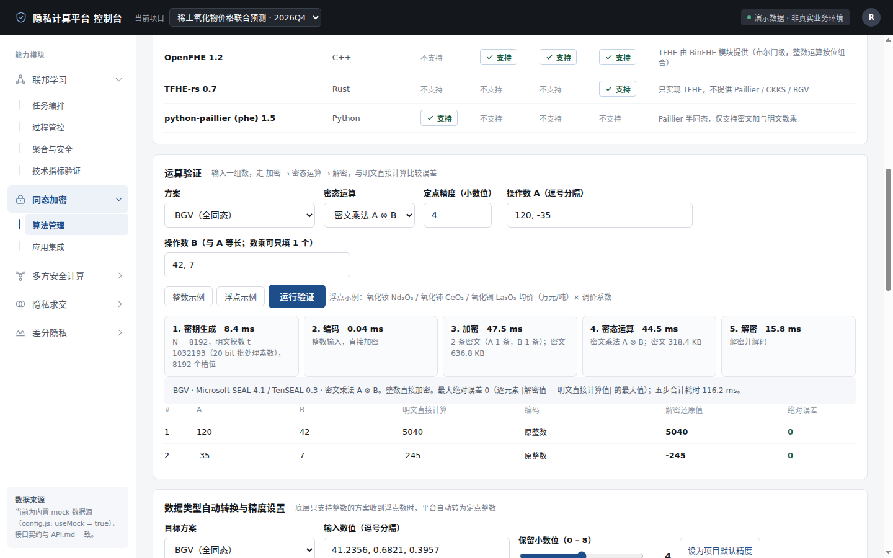

### 5.1.5 浮点型数据同态加密（HE-ALGO-05）

功能说明：支持浮点型数据的同态加密、密态运算与解密还原

界面位置：算法管理 → 「运算验证」卡片（浮点输入）

操作步骤：

1. 方案选 CKKS，点「浮点示例」（氧化钕 / 氧化铈 / 氧化镧 均价 × 调价系数）
2. 分别运行密文加法与密文乘法，比较最大绝对误差
3. 方案改为 Paillier、运算为密文加法，查看「编码后整数」列（如 41.2356 → 412356）与还原误差

预期结果：CKKS 浮点加、乘解密结果为近似值，乘法误差大于加法误差；Paillier 浮点输入自动定点化后误差不超过 0.5 × 10^-p

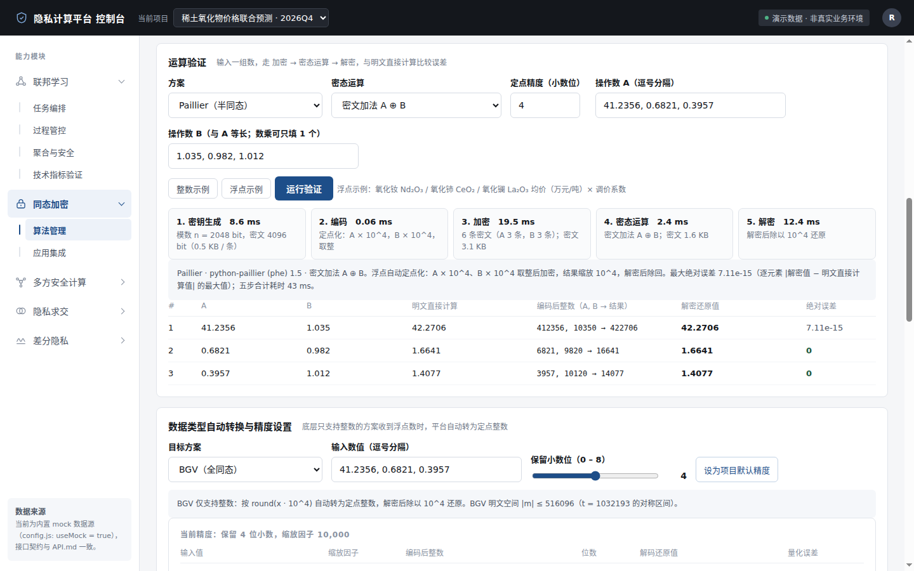

### 5.1.6 数据类型自动转换（HE-ALGO-06）

功能说明：用户输入浮点数但底层算法仅支持整数时，系统自动转换为定点数（可配置精度）

界面位置：算法管理 → 「数据类型自动转换与精度设置」卡片左侧表

操作步骤：

1. 目标方案选 BGV（或 Paillier / TFHE），输入 41.2356, 0.6821, 0.3957
2. 查看提示：BGV 仅支持整数，按 round(x · 10^p) 自动转为定点整数
3. 表中逐个查看缩放因子、编码后整数、位数、解码还原值、量化误差
4. 目标方案改为 CKKS，提示原生支持浮点无需转换

预期结果：浮点输入被转为定点整数，给出缩放因子与还原值；全整数输入缩放因子为 1；CKKS 不做转换

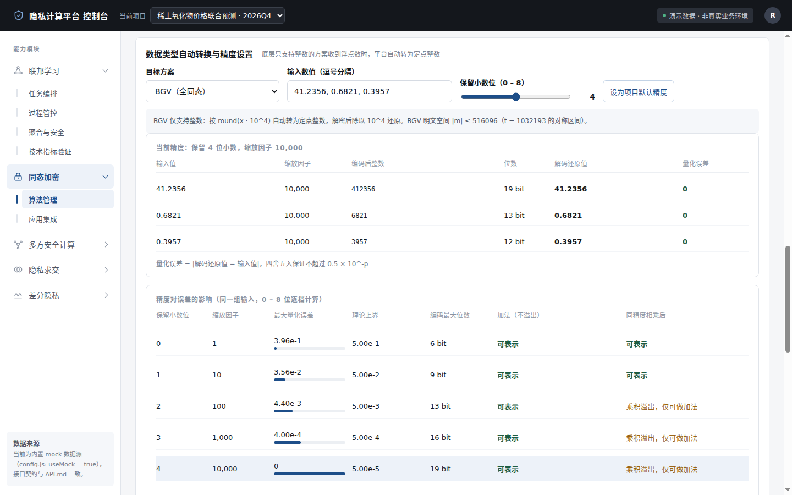

### 5.1.7 浮点数转换精度设置（HE-ALGO-07）

功能说明：支持手动设置浮点数转换精度（如保留小数位数）

界面位置：算法管理 → 「数据类型自动转换与精度设置」卡片的保留小数位滑块、「精度对误差的影响」表、「设为项目默认精度」按钮；「加密算法配置」默认保留小数位

操作步骤：

1. 拖动保留小数位滑块 0–8，左侧编码结果实时刷新
2. 查看右侧逐档表：最大量化误差、理论上界、编码最大位数、加法与乘法后是否溢出，当前档高亮
3. BGV 下观察 p ≥ 5 时 41.2356 编码溢出、p ≥ 1 时同精度相乘溢出
4. 点「设为项目默认精度」，加密算法配置提示行更新

预期结果：精度每增 1 位，误差上界缩小 10 倍、编码位数约增 3.3 bit；超出明文空间的档位标注拒绝加密；默认精度保存到项目配置

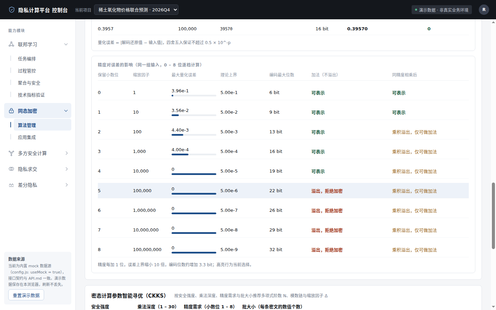

### 5.1.8 密态计算参数智能寻优（HE-ALGO-08）

功能说明：按安全强度、乘法深度、精度需求推荐多项式阶数与模数链，并给出性能估计

界面位置：算法管理 → 「密态计算参数智能寻优（CKKS）」卡片

操作步骤：

1. 输入安全强度 128 位、乘法深度 2、精度需求 6 位小数、批大小 4096，点「开始寻优」
2. 查看推荐：N = 8192、模数链 [60, 40, 40, 60] bit、Δ = 2^40、加 / 乘估算耗时、密文 384 KB
3. 查看候选对比：N = 4096 不可行（200 bit > 109 bit 上限），N = 8192 推荐，N = 16384 可行但开销更大
4. 把深度改为 3，推荐升到 N = 16384；改为 256 位、深度 20、8 位小数，提示无可行解
5. 阅读「寻优依据」

预期结果：给出推荐 N、模数链、Δ 与性能估计，2–3 个候选对比，并写明依据；不可行输入返回 40003 及原因

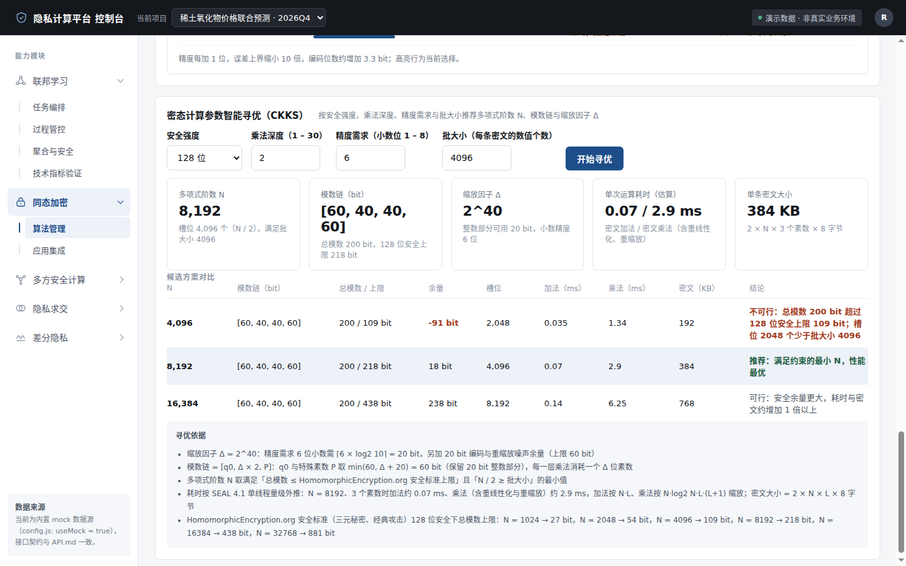

## 5.2 应用集成

页面入口：左侧导航「同态加密」→「应用集成」。

### 5.2.1 可视化配置（HE-APP-01）

功能说明：提供“加密-计算-解密”全流程的可视化配置界面，支持步骤式引导

界面位置：应用集成 → 步骤条与步骤引导、「参数配置」、「执行面板」

操作步骤：

1. 选择加密算法、填写明文 A / B、选择密态运算与精度
2. 按步骤引导依次点 ① 生成密钥对、② 加密、③ 密态运算、④ 解密，步骤条与引导文字随之推进
3. 执行面板逐步显示公钥摘要、密文预览、耗时与密文大小，最后显示校验通过
4. 生成的会话密钥同时出现在下方密钥管理列表（用途「流程会话」），点「重置」后标记已销毁

预期结果：四步按序可用，未到的步骤按钮禁用；解密结果与明文计算一致；切换项目时本次密钥被销毁、流程回到第 0 步

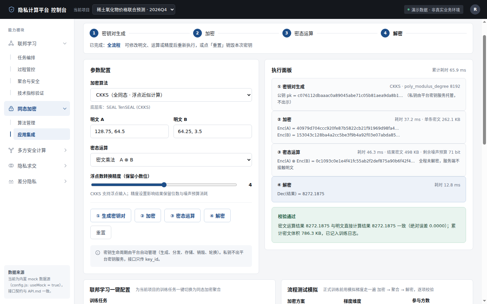

### 5.2.2 联邦学习一键配置（HE-APP-02）

功能说明：支持在联邦学习任务中一键启用同态加密

界面位置：应用集成 → 「联邦学习一键配置」卡片

操作步骤：

1. 在训练任务下拉中选择当前项目的任务（显示状态与当前聚合方式）
2. 对「已创建 / 已终止 / 失败」且为秘密共享聚合的任务点「一键启用同态加密聚合」
3. 启用后显示本任务聚合公钥：key_id、Paillier 2048 bit、SHA256 指纹、公钥前 64 位、生成时间
4. 选择「已完成」或运行中的任务，按钮禁用并提示原因，提供「去过程管控」入口

预期结果：允许状态下一键切换为 he 聚合并显示公钥；其他状态有明确提示，后端对运行中 / 暂停任务返回 40901

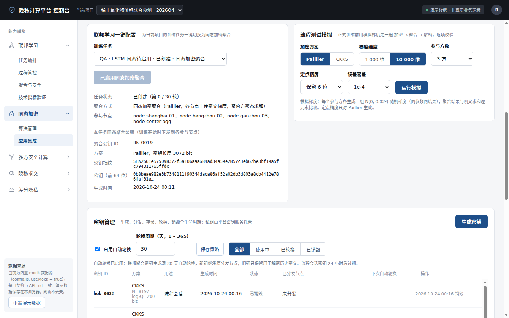

### 5.2.3 密钥管理（HE-APP-03）

功能说明：自动管理密钥生命周期：包括密钥生成、分发、存储、销毁，支持自动密钥轮换

界面位置：应用集成 → 「密钥管理」卡片（生成密钥、轮换策略、状态筛选、密钥表的分发 / 轮换 / 销毁）

操作步骤：

1. 查看密钥表：密钥 ID、方案与参数、用途、生成时间、状态（使用中 / 已轮换 / 已销毁及前后继密钥）、已分发节点、下次自动轮换时间
2. 点「生成密钥」，选 Paillier 3072 bit 与分发节点，提交
3. 对新密钥点「分发」追加节点、点「轮换」生成新钥并把旧钥标记为已轮换（新钥继承分发节点）
4. 对密钥点「销毁」并确认，状态变为已销毁
5. 把轮换周期改为 7 天并保存策略，12 天前生成的聚合密钥被自动轮换（标注自动）

预期结果：密钥全生命周期可操作且状态正确；非使用中的密钥不能分发 / 轮换（40901）；自动轮换按周期生效；已轮换密钥拒绝新加密（40901），已销毁拒绝（40402）

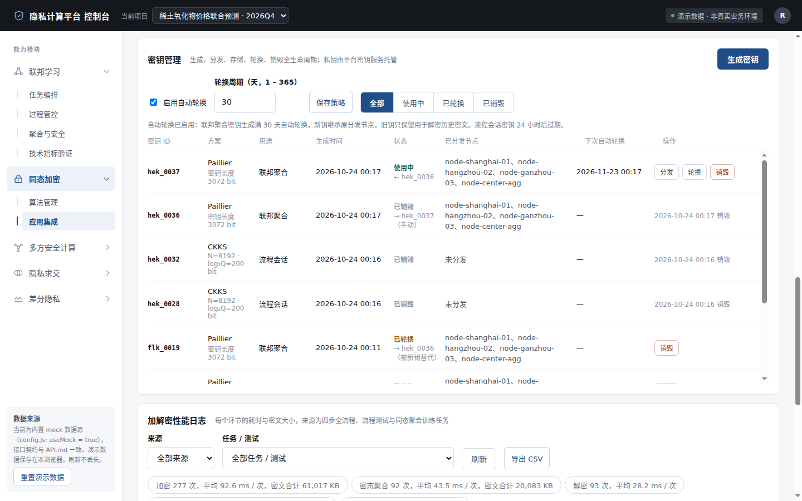

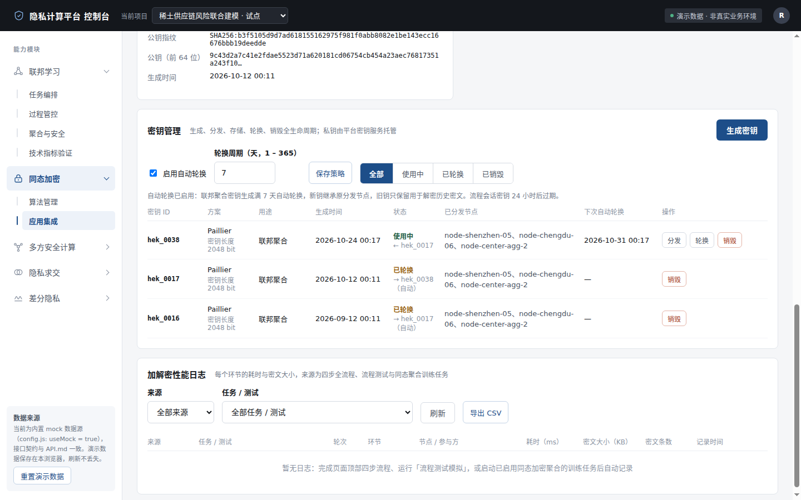

### 5.2.4 流程测试模拟（HE-APP-04）

功能说明：提供全流程测试功能：在正式训练前，可使用模拟梯度验证加解密与聚合的正确性

界面位置：应用集成 → 「流程测试模拟」卡片

操作步骤：

1. 选择加密方案 Paillier、梯度维度 10 000 维、参与方 3 方、定点精度 6 位、容差 1e-4，点「运行模拟」
2. 查看结论横幅、4 步（密钥生成、加密、密态聚合、解密）耗时与密文条数 / 大小
3. 查看逐项校验：密文条数一致、聚合维度、最大绝对误差 ≤ 容差、打包槽位不溢出
4. 把定点精度改为 2 位再运行，结论为未通过并给出原因

预期结果：正常参数下判定通过；精度不足导致误差超容差时判定未通过并说明；结果同时写入性能日志

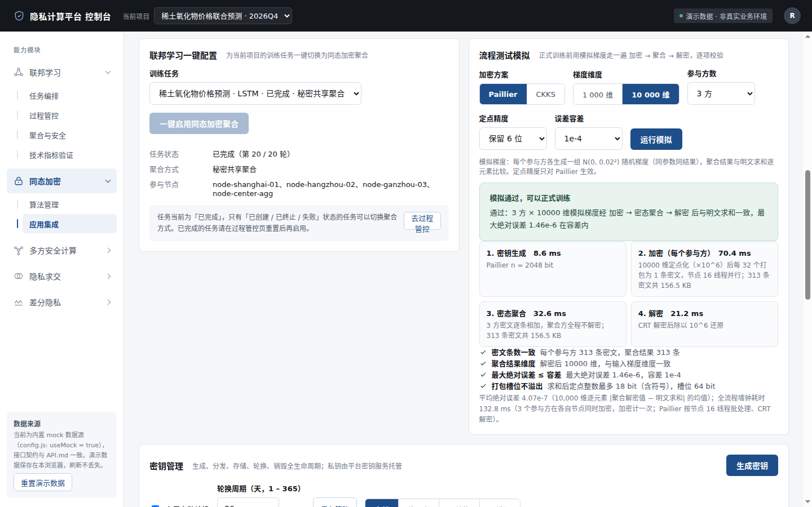

### 5.2.5 日志（HE-APP-05）

功能说明：在训练日志中记录每个环节的加解密耗时与密文大小，便于性能分析

界面位置：应用集成 → 「加解密性能日志」卡片（来源、任务 / 测试筛选、刷新、导出 CSV、环节汇总、日志表）

操作步骤：

1. 完成页面顶部四步流程，日志表出现来源「全流程配置」的 4 条记录
2. 运行一次流程测试模拟，日志表出现密钥生成、各参与方加密、密态聚合、解密记录
3. 在过程管控启动一个已启用同态加密聚合的训练任务，回到本页点「刷新」，出现按轮次的加密 / 聚合 / 解密记录
4. 来源选「训练任务」并在任务下拉中选择该任务，只显示该任务日志
5. 点「导出 CSV」下载当前筛选结果

预期结果：每条日志写明环节、节点或参与方、耗时（ms）、密文大小（KB）与条数；可按来源与任务 / 测试筛选并导出 CSV

# 6 多方安全计算

## 6.1 协议管理

页面入口：左侧导航「多方安全计算」→「协议管理」。

### 6.1.1 秘密共享协议（MPC-PROTO-01）

功能说明：内置秘密共享协议：支持安全求积、求均值

界面位置：协议管理 → 协议目录「秘密共享」卡片；计算流程编排 → 「试运行」结果区

操作步骤：

1. 打开多方安全计算 / 协议管理，查看「秘密共享」卡片：原理、安全模型（半诚实默认 / 恶意可选）、适用算子（安全求和、安全求积、安全求均值）、通信轮数特征
2. 在计算流程编排点示例「各方求和 → 求均值 → 与阈值比较」，点「试运行」
3. 查看各输入方的输入只以加法份额（模 2^64，定点 16 位小数）形式出现在 3 个计算方，结果区只对输出方 参与方 C 公开
4. 把第 3 步协议改为「秘密共享」，确认就地提示不兼容，试运行被拒绝

预期结果：求积 / 求均值可在秘密共享下试运行；份额表不含任何明文报价；安全比较选秘密共享返回 40001

### 6.1.2 混淆电路协议（MPC-PROTO-02）

功能说明：内置混淆电路协议：支持安全比较、逻辑运算

界面位置：协议管理 → 协议目录「混淆电路」卡片；协议参数 → 混淆电路页签；计算流程编排

操作步骤：

1. 查看「混淆电路」卡片：适用算子安全比较、安全最大值、逻辑运算，常数轮特征
2. 点示例「两方报价比较 → 任一为真」并试运行，结果为布尔值，输入以 128 bit 导线标签形式展示
3. 打开高级模式，在混淆电路页签关闭 Free-XOR 与半门优化，观察性能预估通信量上升
4. 把逻辑运算放到第 1 步，确认提示「不能作用于各方私有数据」

预期结果：安全比较（逐行比较前两个输入方，百万富翁问题）与 AND / OR / NOT 正常输出；关闭 Free-XOR / 半门后通信量增加；类型不匹配返回 40000

### 6.1.3 不经意传输协议（MPC-PROTO-03）

功能说明：内置不经意传输扩展：支持向量OT

界面位置：协议管理 → 协议目录「不经意传输扩展」卡片；协议参数 → 不经意传输扩展页签

操作步骤：

1. 查看「不经意传输扩展」卡片：IKNP OT 扩展原理，适用算子向量 OT
2. 点示例「向量 OT 取第 2 行」试运行，输出方得到两个输入方第 2 行组成的向量
3. 在性能预估把数据规模改为 1,000,000 行，在高级模式把扩展批大小改为 1,024，观察交互轮数从 35 轮升到 1,957 轮
4. 把行号改为 9 试运行，提示行号应在 1–4 之间

预期结果：向量 OT 结果只含所选行；轮数 = 3 + 2·⌈m / 批大小⌉；行号越界 40003、非整数 40002

### 6.1.4 安全多方基础算子（MPC-PROTO-04）

功能说明：支持安全多方求积、求均值、比较等基础算子，用户可组合使用

界面位置：协议管理 → 计算流程编排卡（示例流程、算子 / 协议下拉、算子参数、上移 / 下移 / 删除、添加步骤、试运行）

操作步骤：

1. 点示例「各方求和 → 求均值 → 与阈值比较」，确认每步数据形态：各方私有数据 → 密态向量 → 密态标量 → 密态布尔值
2. 阈值填 1,266,000 元/吨，点「试运行」，结果区显示输出方得到「是 / 否」及判断条件，中间步骤显示「结果保持密态」
3. 用上移 / 下移交换第 2、3 步，就地提示类型不匹配；删除步骤、添加步骤（自动选取可接上一步输出的算子）
4. 把第 2 步协议改为混淆电路，试运行与创建均被拒绝

预期结果：合法流程试运行得到确定性结果（同输入同输出），结果只对输出方公开；算子与协议不兼容 40001，类型不匹配 40000，比较缺阈值 40002，超过 8 步 40000

### 6.1.5 3方计算（MPC-PROTO-05）

功能说明：支持不少于3方参与计算，动态配置各方角色（输入方/计算方/输出方）

界面位置：协议管理 → 参与方与角色卡（参与勾选 + 输入方 / 计算方 / 输出方多选）

操作步骤：

1. 默认勾选参与方 A（输入 + 计算）、B（输入 + 计算）、C（计算 + 输出），汇总行显示「角色配置满足要求」
2. 勾选参与方 D（node-center-agg）并只给输入方角色，创建 4 方任务
3. 取消参与方 C，汇总行提示「至少需要 3 个参与方，当前 2 个；缺少输出方」，点创建被拦截
4. 只保留 1 个计算方，提示秘密共享 / 混淆电路需要至少 2 个计算方

预期结果：≥ 3 方且输入方、计算方、输出方各至少 1 个才能创建；少于 3 方、缺角色、重复参与方返回 40000，参与方不存在 40400

### 6.1.6 参数默认配置（MPC-PROTO-06）

功能说明：提供协议参数的默认配置，并支持高级用户自定义参数

界面位置：协议管理 → 协议参数卡（协议页签、高级模式开关、恢复默认、保存参数）

操作步骤：

1. 查看秘密共享默认参数：环大小 64 bit、定点小数位 16 bit、半诚实；混淆电路 Free-XOR 开、半门开、位宽 32 bit；OT 基础 OT 数 128 次、扩展批大小 65,536 条 / 批
2. 打开高级模式，把环大小改为 128 bit，性能预估通信量随之翻倍；定点小数位填 70，就地提示越界、保存返回错误
3. 改为 24 后保存，页签显示「已自定义」，新建任务采用该值；点「恢复默认」回到 64 / 16

预期结果：默认参数可见；高级模式下可修改并按项目保存；越界 40003、格式错 40002、未知参数 40000；恢复默认后 customized = false

### 6.1.7 性能预估（MPC-PROTO-07）

功能说明：提供协议性能预估功能，根据参与方数量、数据规模，预估算法和通信耗时

界面位置：协议管理 → 性能预估卡（数据规模、带宽、RTT 输入，4 个指标卡，逐步明细表，公式说明）

操作步骤：

1. 默认 3 方、1,200,000 行、100 Mbps、20 ms 下查看预估计算耗时、预估通信耗时（传输 + 时延）、预估通信量（MB 与字节数）、交互轮数
2. 把数据规模改为 2,400,000 行或勾选第 4 个参与方，指标随之增长
3. 查看逐步明细：输入分享、各算子、A2Y 份额转换的通信量、计算耗时、轮数与公式
4. 带宽填 0，提示越界

预期结果：预估随参与方数与数据规模单调增长，带宽翻倍传输时间减半；每个数字带单位与公式说明；参与方 < 3 返回 40000，行数 / 带宽越界 40003

## 6.2 运维监控

页面入口：左侧导航「多方安全计算」→「运维监控」。

### 6.2.1 通信量监控（MPC-OPS-01）

功能说明：展示每个参与方当前的通信量

界面位置：运维监控 → 「总通信量」指标卡；参与方卡片「累计通信量」行（数值 + 条形 + 偏离均值）

操作步骤：

1. 在协议管理页点「创建任务并进入监控」，自动跳到运维监控并选中新任务
2. 观察总通信量（各方累计发送之和，附单方均值）与每张参与方卡片的累计通信量随心跳增长
3. 点「停止执行」后数值不再变化，「继续执行」继续增长，「重置」清零

预期结果：每方通信量从 0 递增到预估值附近（各方 ±6% 扰动），总通信量 = 各方之和；停止后冻结，重置后归零；已结束任务再 start 返回 40901；任务停止后参与方状态显示「已停止」（与任务一致，降级节点仍标异常），累计指标保留

### 6.2.2 计算耗时监控（MPC-OPS-02）

功能说明：展示每个参与方的计算耗时

界面位置：运维监控 → 「最长计算耗时」指标卡；参与方卡片「累计计算耗时」行

操作步骤：

1. 执行中观察每方累计计算耗时（秒）与条形长度（相对最慢一方）
2. 指标卡显示最慢一方的累计计算耗时与各方均值
3. 任务结束后对照摘要卡中的预估计算耗时

预期结果：每方计算耗时随进度递增，结束时与预估计算耗时一致（误差为各方扰动系数）

### 6.2.3 轮次交互数监控（MPC-OPS-03）

功能说明：展示协议执行过程中的轮次交互次数

界面位置：运维监控 → 「轮次交互数」指标卡；参与方卡片「轮次交互次数」行

操作步骤：

1. 执行中观察轮次交互数从 0 增长到预估总轮数（示例流程 8 轮）
2. 换成向量 OT 且扩展批大小较小的任务，轮数显著增加

预期结果：轮次交互数 = round(预估总轮数 × 进度)，结束时等于预估总轮数

### 6.2.4 异常节点检测（MPC-OPS-04）

功能说明：自动检测异常节点：当某参与方通信量或耗时显著偏离平均值时，系统应高亮告警

界面位置：运维监控 → 告警条（含「定位节点」按钮）、判定规则说明、「异常节点」指标卡、参与方卡片红色高亮

操作步骤：

1. 用默认参与方 A / B / C 创建任务，执行约 2 秒后出现两条告警：参与方 C（node-ganzhou-03）累计通信量为均值的约 1.6 倍（偏离 +6x%），累计计算耗时偏离 +5x%，超过 ±50% 阈值
2. 参与方 C 卡片边框与条形变红、状态为「异常」，点「定位节点」滚动并闪烁高亮该卡片
3. 改用 A / B / D 创建对照任务，全程无告警；创建时把异常阈值设为 200%，降级节点也不告警

预期结果：偏离均值超过阈值的参与方被高亮并告警，告警给出倍数、偏离率与阈值；正常节点不误报；阈值 < 10% 或 > 200% 返回 40003

### 6.2.5 历史MPC任务查询（MPC-OPS-05）

功能说明：提供历史MPC任务的指标查询与对比功能，支持导出报表

界面位置：运维监控 → 历史 MPC 任务卡（协议筛选、结束日期范围、查询 / 清空筛选、对比勾选、对比所选、导出报表、查看）与任务对比面板

操作步骤：

1. 查看 6 条播种历史任务（含名称、计算流程 / 协议、参与方、数据规模、总通信量、总耗时、告警数、结束时间）
2. 协议选混淆电路、结束日期 2026-10-01 至 2026-10-31，点查询，只剩含混淆电路的 10 月任务
3. 勾选 2 个任务点「对比所选」，查看总通信量、单方平均通信量、总耗时、轮次交互数、每万行耗时等指标与差异 %；勾第 3 个被拦截
4. 点「导出报表」得到按当前筛选的 CSV，点「导出对比报表」得到含对比段的 CSV；点某行「查看」在上方监控区展示该任务最终指标

预期结果：筛选结果与条件一致；对比只允许 2 个任务；导出文件行数与列表一致；日期格式错 40002、起止颠倒 40000、对比数量不对 40000、任务不存在 40400

# 7 隐私求交

## 7.1 数据接入

页面入口：左侧导航「隐私求交」→「数据接入」。

### 7.1.1 数据集登记（PSI-DATA-01）

功能说明：支持数据库（JDBC）、HDFS、文件上传三种来源登记数据集，平台只存元数据与 schema

界面位置：数据接入 → 已接入数据集卡 → 「＋ 接入数据」弹窗

操作步骤：

1. 点击「＋ 接入数据」
2. 填写数据集名称、所属参与方，数据来源分别选数据库（JDBC）/ HDFS 路径 / 上传文件
3. 填写求交键列与可选时间列后点击「开始接入」

预期结果：列表出现新数据集，来源、来源地址、求交键与填写一致；JDBC 地址格式错误、HDFS 路径不以 hdfs:// 开头、同参与方重名时弹窗底部给出错误且不关闭；上传 CSV 时按文件实际内容登记行数与列（首行为表头），Parquet 等无法在浏览器解析的文件行数显示「约 N（估算）」

### 7.1.2 字段与脱敏预览（PSI-DATA-02）

功能说明：查看数据集字段、求交键、时间列，样例数据脱敏展示

界面位置：数据接入 → 数据集行「详情」→ 下方字段与脱敏样例卡

操作步骤：

1. 在已就绪数据集行点击「详情」
2. 查看字段标签（求交键、时间列高亮）与脱敏样例表

预期结果：字段列表标出求交键与时间列；样例只显示前 3 行、前 6 列，求交键为 6 位哈希前缀加省略号，字符串列打码 ***，数值列为归一化值；接入中的数据集「详情」按钮不可用；上传文件的样例取文件真实前 3 行（不足按实际行数）脱敏，未在浏览器解析的文件显示「无样例（文件未在浏览器解析）」

### 7.1.3 数据集状态与删除（PSI-DATA-03）

功能说明：接入中→就绪状态流转；被运行中流水线引用时禁止删除

界面位置：数据接入 → 数据集列表「状态」列与「删除」按钮

操作步骤：

1. 新接入一个数据集，观察状态由「接入中」变为「已就绪」
2. 在平台集成页启动流水线后回到数据接入页，删除流水线所用数据集
3. 流水线结束或重置后再次删除

预期结果：接入中时页面自动轮询，就绪后行数出现；运行中流水线引用的数据集删除时弹窗提示「数据集正被运行中的求交流水线使用」，流水线结束后可删除；删除已完成流水线用过的数据集后，该流水线的两方行数、交集条数、特征维度与数据集名保持不变

## 7.2 算法配置

页面入口：左侧导航「隐私求交」→「算法配置」。

### 7.2.1 多种PSI协议（PSI-ALGO-01）

功能说明：实现三种PSI协议：ECDH-PSI、KKRT（基于OT）、非平衡PSI

界面位置：算法配置 → 「PSI 协议」卡（三张单选卡 + 安全强度说明框）

操作步骤：

1. 打开算法配置页
2. 依次点选 ECDH-PSI、KKRT（基于 OT）、非平衡 PSI
3. 查看每个协议右侧「128 位」标签与下方安全强度说明

预期结果：三种协议可切换，参数调优区随之切换；说明框写明安全基础、128 位计算安全依据（ECDH 用 Curve25519 / P-256，KKRT 的 OT 安全参数 λ = 128）与敌手模型

### 7.2.2 PSI参数调优（PSI-ALGO-02）

功能说明：提供PSI参数调优界面，不同协议展示对应的参数项

界面位置：算法配置 → 「参数调优」卡（下拉 / 数字框 / 开关 +「恢复默认」「保存为当前配置」）

操作步骤：

1. 选择协议后修改参数，例如 KKRT 布谷鸟哈希桶数输入 3
2. 观察该行红字「范围 1.1 – 2」且保存按钮不可用
3. 改为 1.4 后点击「保存为当前配置」

预期结果：每个协议显示自己的参数项：枚举为下拉、数值为带范围与单位的数字框、布尔为开关；非法值就地提示并禁止保存；保存后底部显示「当前配置：KKRT（基于 OT）· 来源：手动调整 · 保存于 …」

### 7.2.3 PSI配置模板（PSI-ALGO-03）

功能说明：支持保存和加载PSI配置模板

界面位置：算法配置 → 「配置模板」卡（模板名称 +「保存为模板」、模板列表「加载」「删除」）

操作步骤：

1. 调好参数后输入模板名称，点击「保存为模板」
2. 在列表点击某模板「加载」
3. 删除自建模板；平台集成页「配置来源」下拉中可直接选模板

预期结果：新模板出现在列表首行并显示参数摘要；加载后协议与参数切换为模板值，并成为当前配置（来源：模板「…」），该行按钮变为「使用中」；重名在卡片内红字提示；内置模板删除按钮不可用

### 7.2.4 求交协议自适应路由（PSI-ALGO-04）

功能说明：按双方数据量级、网络带宽推荐 PSI 协议与参数，给出预估耗时与通信量；协议满足 128 位安全强度

界面位置：算法配置 → 「求交协议自适应路由」卡 +「典型场景性能参考」表

操作步骤：

1. 输入参与方 A / B 数据量（行）、网络带宽（Mbps）、单向延迟（ms），默认取本项目两方截面数据集行数
2. 点击「计算推荐」，查看推荐协议、理由、推荐参数与三协议对比表
3. 点击「采用推荐」
4. 查看下方典型场景表

预期结果：给出推荐协议与参数及理由，对比表列出三种协议在线预估耗时（秒）、计算 / 网络耗时、通信量（MB）、离线预处理与 128 位安全强度；1 亿 × 1 万推荐非平衡 PSI；「采用推荐」后参数调优区切换为推荐配置，来源显示「自适应路由推荐」；非法输入在卡片内红字提示

## 7.3 平台集成

页面入口：左侧导航「隐私求交」→「平台集成」。

### 7.3.1 一键启动（PSI-PIPE-01）

功能说明：提供“安全求交 → 特征对齐 → 联合训练”的一键启动流水线

界面位置：平台集成 → 「求交配置」卡（配置来源下拉 + 参数摘要 +「去算法配置修改」）、「求交数据」卡、「一键流水线」卡

操作步骤：

1. 在「配置来源」选择「当前算法配置」或某个模板，核对参数摘要
2. 选择两方数据集与求交键
3. 点击「一键启动」，完成后点击「前往训练」

预期结果：流水线按所选配置依次执行安全求交 → 特征对齐 → 联合训练，完成后绿框显示写入的联邦项目与训练任务 ID，「前往训练」跳转到联邦学习 / 过程管控并定位该任务；交集少于 100 条时流水线在安全求交阶段失败，特征对齐与联合训练显示「已跳过」，不生成训练任务，页面红框写明原因

### 7.3.2 进度跟踪（PSI-PIPE-02）

功能说明：支持在流水线执行过程中提供可视化进度追踪（各步骤状态、执行时长、数据量）

界面位置：平台集成 → 三张阶段卡（状态、进度条、执行时长、数据量）+ 一键流水线卡说明行

操作步骤：

1. 启动流水线后观察三张阶段卡
2. 切到算法配置页再切回平台集成页
3. 点击「重置」

预期结果：各阶段显示待执行 / 执行中 / 已完成、进度条、执行时长（秒）、数据量（求交为两方行数与交集条数，对齐为条数与特征维度）；说明行显示流水线 ID、协议与各阶段执行时长合计；切页回来进度继续推进；重置后三张卡回到待执行；失败时失败阶段标红「失败」，后续阶段「已跳过」

# 8 差分隐私

## 8.1 隐私机制

页面入口：左侧导航「差分隐私」→「隐私机制」。

### 8.1.1 差分隐私机制（DP-MECH-01）

功能说明：支持不少于两种差分隐私机制：高斯机制、拉普拉斯机制

界面位置：隐私机制 → 「机制与参数」页签 → 「差分隐私机制」卡

操作步骤：

1. 进入差分隐私 / 隐私机制
2. 查看高斯机制、拉普拉斯机制两张机制卡的定义、噪声分布、敏感度、适用场景、核心参数
3. 对照下方同方差噪声密度对比图

预期结果：至少两种机制：高斯 (ε, δ)-DP、拉普拉斯 ε-DP，各自写明定义、噪声分布与定标公式、适用场景；当前任务在用的机制有标识

### 8.1.2 参数配置（DP-MECH-02）

功能说明：支持为每种DP机制配置核心参数

界面位置：隐私机制 → 「机制与参数」页签 → 「参数配置」卡（作用对象：梯度 / 统计查询）

操作步骤：

1. 顶部选择训练任务
2. 作用对象选「梯度（联邦训练任务）」，设置机制、总预算 ε、δ、裁剪阈值 C、裁剪方式、会计方式，观察实时预估
3. 点击「保存到任务」；任务训练中时保存被拒并提示错误码 40901
4. 作用对象切到「统计查询（数据集字段）」，选数据集字段、查询、单次 ε、裁剪方式，保存并「执行一次加噪查询」

预期结果：参数写入任务后，效果评估页左栏与本页显示一致；运行中任务提示「任务运行中不允许修改 DP 配置」；统计查询发布只返回加噪结果

### 8.1.3 自适应噪声注入（DP-MECH-03）

功能说明：按数据分布特征（敏感度、取值范围）自适应确定噪声尺度

界面位置：隐私机制 → 「自适应噪声注入」页签（数据集字段 / 训练梯度）

操作步骤：

1. 选稀土价格数据集 ds_{project}_ree_price 的 ceo2_price，查询「月度均价」，拉普拉斯，ε = 0.5
2. 查看字段统计（中位数、均值、P5–P95、公开取值范围，单位元/吨）与分布图上的裁剪区间
3. 对比「固定裁剪 vs 自适应裁剪」表中的敏感度、噪声标准差、裁剪偏差、RMSE
4. 切到「训练梯度」，查看每轮样本梯度范数、固定 C 与自适应 C、裁剪比例，点击「对任务启用自适应裁剪」

预期结果：重尾字段（CeO₂ 月度均价）推荐自适应裁剪，噪声标准差降低约 84%；样本量大的全量均值推荐固定裁剪；梯度自适应裁剪的裁剪比例稳定在 50% 附近且平均噪声 σ 下降

### 8.1.4 差分隐私策略动态编排（DP-MECH-04）

功能说明：按组合定理（基础 / 高级 / RDP）编排多维数据分析的隐私保护强度并下发到任务

界面位置：隐私机制 → 「策略动态编排」页签（组合定理对比 / 新建 DP 策略 / 已编排策略）

操作步骤：

1. 在「组合定理对比」输入单步 ε₀、δ、步数 T，对比基础组合、高级组合、RDP 会计的累计 ε 与曲线
2. 在「新建 DP 策略」设定总预算、δ、机制、会计方式，添加训练任务维度与字段查询维度并设置权重
3. 点击「生成策略」，在「已编排策略」查看每个维度分到的 ε 与三种会计方式下的每步噪声倍数
4. 点击「下发到训练任务」；查询维度点「发布一次」按次消耗

预期结果：同样 30 轮、ε₀ = 0.0667 时累计 ε：基础 2.00、高级 1.89、RDP 0.37；策略按权重分配 ε 并写入绑定任务（任务 DP 配置显示 policy_id）；绑定任务运行中时下发被拒（40901）

## 8.2 效果评估

页面入口：左侧导航「差分隐私」→「效果评估」。

### 8.2.1 效果展示（DP-EVAL-01）

功能说明：训练过程中实时计算并展示已消耗隐私预算、模型效用等指标

界面位置：效果评估 → 顶部「训练任务」下拉、左栏「DP 机制配置」、三张指标卡、噪声分布

操作步骤：

1. 选择训练任务（与隐私机制页共用）
2. 查看「已消耗隐私预算（累计 ε）」「模型效用（预估 Accuracy）」「每轮 ε 消耗 / 单轮机制 ε」
3. 在过程管控启动训练后回到本页，预算与轮次每 2 秒刷新

预期结果：训练中已消耗 ε、占比、已完成轮次实时增长；会计方式与累计 δ 写在指标卡说明里；模型效用以百分比显示并给出无噪声基线与损失百分点

### 8.2.2 效用曲线（DP-EVAL-02）

功能说明：效用趋势曲线，提供隐私预算消耗趋势曲线

界面位置：效果评估 → 「趋势曲线」卡、「效用-隐私平衡分析」卡

操作步骤：

1. 查看累计 ε 消耗与模型效用随轮次的趋势曲线，虚线为当前已完成轮次
2. 查看「效用-隐私平衡分析」：不同总预算 ε 下预估效用曲线、无噪声基线、当前 ε 标记
3. 拖动左栏 ε 滑块，平衡分析与当前标记同步更新

预期结果：效用随 ε 单调不降；给出效用损失不超过 3 个百分点的最小 ε（平衡点），并说明当前 ε 在平衡点哪一侧

### 8.2.3 历史记录（DP-EVAL-03）

功能说明：提供历史隐私审计记录，每次迭代的ε消耗、噪声添加详情

界面位置：效果评估 → 「隐私审计记录」卡（查看全部 / 导出 CSV）

操作步骤：

1. 查看最近 5 轮：轮次、本轮 ε 增量、累计 ε、噪声添加详情（σ 或 b、δ、被裁剪样本梯度占比）、裁剪阈值 C
2. 点击「查看全部」在弹窗中查看全部轮次
3. 点击「导出 CSV」下载 {job_id}_dp_audit.csv

预期结果：每轮一条记录，逐轮增量之和等于累计 ε；已完成的历史任务也能看到全部轮次；CSV 列与页面一致

## 8.3 框架集成

页面入口：左侧导航「差分隐私」→「框架集成」。

### 8.3.1 隐语集成（DP-FW-01）

功能说明：基于隐语原生DP模块进行封装，保留接口可替换性

界面位置：框架集成 → 「隐语集成 · DP 适配层」卡

操作步骤：

1. 查看当前实现、适配层版本说明、支持的机制与会计方式
2. 查看接口映射表：平台接口 ↔ 实现类 / 函数，来源标注「框架原生」或「平台适配器」
3. 在「实现」下拉选 Opacus 预览映射，点击「切换实现」

预期结果：平台接口固定为 DPStrategy.build、GradientDP.gaussian、GradientDP.laplace、Accountant.spent、SecureAggregator.aggregate；隐语原生类（DPStrategyFL、GaussianModelDP、SecureAggregator）与适配器补齐项分开标注；切换后本项目待启动 / 失败 / 已终止任务改用新实现，已完成任务与其他项目不变，提示写明影响范围与任务数

### 8.3.2 DP初始化（DP-FW-02）

功能说明：在训练引擎中初始化DP机制，若任务配置启用DP，则在梯度聚合前自动调用

界面位置：框架集成 → 「DP 初始化与 hook 链」卡

操作步骤：

1. 选择启用 DP 的任务，查看初始化状态与 hook 点 before_aggregate
2. 启动训练后观察 数据加载 → 本地训练 → 梯度裁剪 → 加噪 → 安全聚合 → 预算记账 六步的状态与调用次数逐轮增加
3. 对未启用 DP 的任务，裁剪、加噪、记账显示「未启用」

预期结果：启用 DP 的任务启动后显示「DP 已在训练引擎中初始化」，裁剪 / 加噪调用次数 = 轮数 × 参与方数，聚合 / 记账 = 轮数；未启用时 DP 三步跳过

### 8.3.3 DP指标查看（DP-FW-03）

功能说明：支持查看框架内部DP相关指标（如噪声分布直方图）

界面位置：框架集成 → 「框架内部 DP 指标」卡

操作步骤：

1. 选择已训练过的任务（或训练中任务）
2. 查看平均裁剪比例、末轮噪声 L2 范数、末轮信噪比（dB）、噪声抽样数
3. 查看每轮裁剪比例曲线、每轮信噪比曲线、噪声分布直方图（实际抽样 vs 理论密度）

预期结果：指标逐轮更新；直方图抽样分布与理论密度吻合；没有 DP 轮次时显示空态说明

### 8.3.4 联邦差分隐私端到端工作流（DP-FW-04）

功能说明：DP 与联邦训练端到端标准化工作流：配置→初始化→裁剪加噪→聚合→预算记账

界面位置：框架集成 → 「联邦差分隐私端到端工作流」向导（5 步）

操作步骤：

1. ① 选择训练任务（待启动 / 失败 / 已终止可直接启动）
2. ② 手动设置机制与参数并保存，或选用已编排策略并下发
3. ③ 初始化检查：DP 启用、参数范围、实现可用、噪声定标、安全聚合、参与方 ≥ 2、任务可启动
4. ④ 启动训练，自动跳转到 联邦学习 / 过程管控 并定位到该任务
5. ⑤ 回到框架集成或点「前往效果评估」查看预算消耗

预期结果：检查全部通过才能进入启动；启动后过程管控显示该任务训练中；第 5 步与效果评估页显示同一任务的已消耗 ε；已完成任务在第 3 步提示需先重置

# 9 常见提示与处理

| 提示码 | 含义 | 处理方法 |
|---|---|---|
| 40000 | 参数不合法（必填项缺失、组合不支持等） | 按弹窗提示修改输入后重新提交 |
| 40001 | 所选加密方案不支持该运算 | 换用支持该运算的方案，例如密文乘密文选 CKKS / BGV |
| 40002 | 数值格式错误 | 输入合法数字 |
| 40003 | 数值超出允许范围 | 按提示的范围调整 |
| 40400 / 40402 | 对象不存在 / 密钥已销毁或过期 | 刷新列表或重新生成密钥 |
| 40901 | 当前状态不允许该操作（如训练中修改配置） | 等任务暂停或结束后再操作 |
| 40902 | 名称重复 | 换一个名称 |
| 42201 | 连通性检查失败（节点离线、数据源不可达） | 检查节点或数据源状态后重试 |
